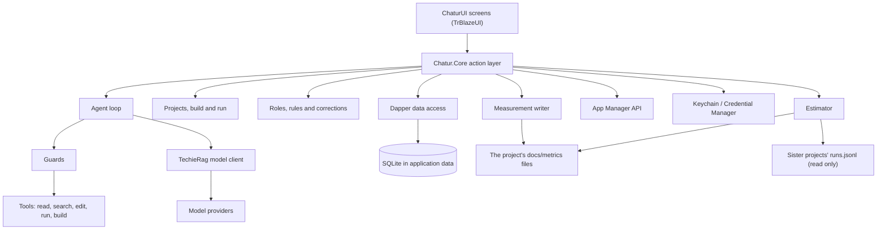
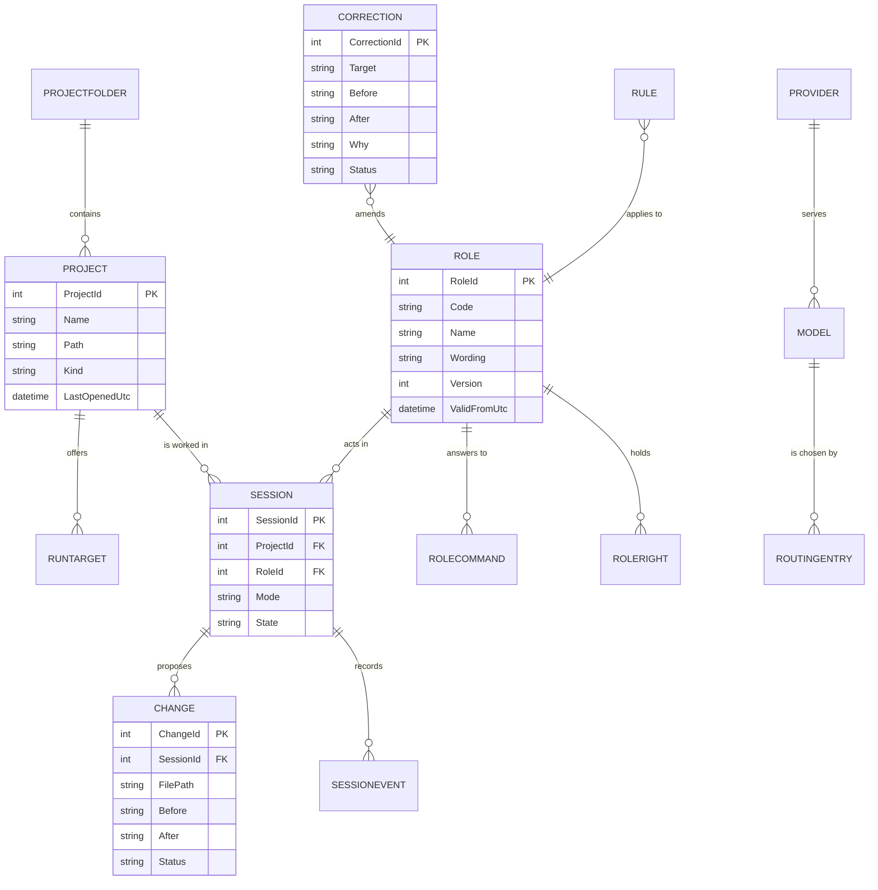

# Chatur — Architecture

| | |
|---|---|
| App | Chatur |
| Kind | app |
| Size | Large |
| Stack answer set | dotnet (`.tfcore/templates/stack-defaults/dotnet.md`) |
| Date | 2026-09-21 |

## 1. Stack decisions

One row per stack question. "Source" says where the answer came from: the answer set, the owner, or the existing code.

| Q | Topic | Decision | Source |
|---|---|---|---|
| Q1 | Configuration | Non-secret settings live in `appsettings.json`, layered by `appsettings.{Environment}.json`. No second settings mechanism is created. Per-machine choices the owner makes in the app (project folders, selected project, run target) are rows in the database, not settings files. | answer set: dotnet |
| Q2 | Secrets in development | Project user secrets (`dotnet user-secrets`) on the developer machine. `appsettings.Development.json` is committed and never holds a real secret. `secrets.example.json` lists every key the application reads. At run time on a real machine, model keys and sign-in tokens are in the operating system's store — see Q4 and §5. | answer set: dotnet |
| Q3 | Database | **Override of the answer set.** SQLite, one file per signed-in account plus one for the install, in the user's application-data folder, never beside the program (amended 2026-11-17, §6). Dapper for data access, DbUp for migrations, no EF Core. A migration that has shipped in a nightly build is never edited; a new one is added. | owner, day-1 (`docs/Chatur-Technical-Decisions.md`) |
| Q4 | Authentication | App Manager, as `docs/AppManager-api-usage-guide.md` describes: `POST /AuthSvc/device-register` and `POST /AuthSvc/device-login` with a `deviceId` generated once per installation and kept, passwords RSA-encrypted with the key from `GET /AuthSvc/public-key`. Tokens live in the Keychain on the Mac and Credential Manager on Windows. Feedback, issues, licences and feature control use App Manager in phase 4. | answer set: dotnet (Q4 asked) + owner, day-1 |
| Q5 | Logging | Serilog, wired at startup before anything else can fail. A log file under the application-data folder beside the database on a real machine, and under `bin/` in development. | answer set: dotnet (file path adjusted for a desktop app, owner day-1) |
| Q6 | Tests | xUnit, from day one, running on macOS and on Windows. Unit tests for `Chatur.Core` and every guard class; Playwright tests against `Chatur.WebHarness` for the screens; the Windows app window is driven by the Windows test bridge, the Mac app window by Appium once the Mac is registered in `core-config.yaml`. | answer set: dotnet + owner, day-1 |
| Q7 | Layout and naming | `src/` and `tests/` at the root. The primary head is named exactly `Chatur`. Secondary projects take a descriptive suffix. | answer set: dotnet |
| Q8 | User interface | TrBlazeUI 2.0.9 (`TrBlazeUI.Components`, `TrBlazeUI.Icons.Lucide`, GitHub Packages feed) for every view. Views live in `ChaturUI`, a Razor class library, and are rendered by a `BlazorWebView` in the MAUI host — interactive by nature, so no Blazor render mode is chosen. The same components render in `Chatur.WebHarness` for the browser checks. TrBlazeUI ships no named themes, only a stock grey set of OKLCH variables, so Chatur names its own: Amber by default, with Indigo, Teal and Slate, each a file of values in the same shape. | answer set: dotnet + owner, day-1 and 2026-09-22 |
| Q11 | Standing rules | The answer set's eleven rules, with two adjustments for a desktop app: log files go to the application-data folder on a real machine (rule 6 keeps `bin/` for development), and migrations live in `ChaturDb` (rule 5) rather than a folder of loose scripts. Added for this product: a model never runs a source-control command by its own choice, and anything TechieRag lacks is added in the TechieRag repository, never worked around in Chatur. | answer set: dotnet + owner, day-1 |

Q9 (hosting) and Q10 (production secrets) are not yet asked; they are answered after user acceptance testing. Chatur ships as a download, so Q9 is about the release pipeline — see §6 and BRD-158 (`.github/workflows/release.yml`).

## 2. Solution structure

| Project | Kind | Purpose |
|---|---|---|
| `Chatur` | MAUI Blazor Hybrid app (Mac Catalyst, Windows) | The primary head. Hosts the `BlazorWebView`, owns platform services: the secret store, the file dialogs, launching processes, opening a file in another program. |
| `ChaturUI` | Razor class library | Every view and component, built with TrBlazeUI. No behaviour beyond presentation. One folder per view: the window shell (menu bar, toolbar, files panel, tab host, conversation panel, output strip), then one component per view that opens as a tab, and one per Settings tab. Every component is a `.razor` file with its own `.razor.cs` code-behind — never markup and logic in one file, and never one page holding several tabs. The themes live here too, as one file of OKLCH values per theme. |
| `Chatur.Core` | class library | Every behaviour behind one action layer: projects, build and run, models and routing, the agent loop, guards, roles and rules, corrections, measurements, source control, App Manager. No screens. |
| `ChaturDb` | migrations project (console) | DbUp migrations and the seed data for roles, rules and process wording. Run by the app at startup. |
| `Chatur.WebHarness` | Blazor web app | Test only. Shows `ChaturUI`'s screens in a browser so the headless browser checks can run on every build. Never shipped to the owner. |
| `Chatur.Tests` | xUnit test project | Unit tests for `Chatur.Core` and every guard class; runs on macOS and on Windows. |

## 3. Component map

**How a request travels** (one typical request, in words; per-screen detail is in the DevGuide):

1. The owner types a message on the Chat screen and presses send. The screen calls one method on the action layer, passing the selected project, the chosen role and the text.
2. The action layer reads the role, its rights and its model tier from the database, then asks the routing component which model to use and hands the conversation to TechieRag.
3. The model answers with a tool request. Every request goes through the guards first: the role's rights, the "ask me first" setting, and the standing refusal of source-control commands. A refused request never reaches a tool.
4. An allowed tool runs — reading a file, editing one, running a build. An edit is held as a proposed change until the owner approves it on the Changes screen, unless the session is in "go ahead".
5. The loop records the step, tokens and model in the session, and in `docs/metrics` where the project has it.
6. The screen shows the reply, the model that answered and the running token count, and the activity panel adds the step.

## 4. Data model

| Entity | Key fields | Notes |
|---|---|---|
| ProjectFolder | `FolderId`, `Path` | A folder the owner named for Chatur to search. |
| Project | `ProjectId`, `Path`, `Name`, `Kind` | Found by searching the folders. One is the selected project. |
| RunTarget | `RunTargetId`, `ProjectId`, `Name`, `Command`, `Platform` | The targets that fit this machine; the one last used is offered first. |
| Provider | `ProviderId`, `Name`, `Connector`, `SignInMethod`, `BaseUrl` | One connector, one sign-in method, one web address, so a new vendor is a new row. The secret itself is in the operating system's store; the row keeps only the name it is stored under. |
| Model | `ModelId`, `ProviderId`, `Tier`, `Identifier` | A model a provider serves, in a tier. |
| RoutingEntry | `RoutingEntryId`, `RoleId`, `WorkKind`, `Tier`, `Order` | The tier for a role and a kind of work, and the order of the fallback chain. |
| Role | `RoleId`, `Code`, `Wording`, `Version`, `ValidFromUtc` | Versioned. An edit writes a new version; the old one stays for the history. |
| RoleRight | `RoleRightId`, `RoleId`, `Action`, `Allowed` | What the role may do. The guards read this and nothing else. |
| RoleCommand | `RoleCommandId`, `RoleId`, `Command`, `Description` | The commands the role answers to. |
| Rule | `RuleId`, `Scope`, `Text`, `Version` | Versioned the same way as Role. |
| ProcessStepText | `StepTextId`, `ProcessCode`, `StepCode`, `Text`, `Version` | The wording of a step. The steps and checks themselves are code. |
| Session | `SessionId`, `ProjectId`, `RoleId`, `Mode`, `State` | `Mode` is "ask me first" or "go ahead". A session can be continued later. |
| SessionEvent | `EventId`, `SessionId`, `Seq`, `Kind`, `Payload`, `Model`, `Tokens` | One row per step: message, tool request, refusal, result. |
| Change | `ChangeId`, `SessionId`, `FilePath`, `Before`, `After`, `Status` | A proposed edit, waiting for approve or reject. |
| Correction | `CorrectionId`, `Target`, `Before`, `After`, `Why`, `Status` | A change Chatur made to a role, rule or step wording, in the same shape as a miss, kept or undone. |
| Setting | `Key`, `Value` | Per-machine choices made in the app, including the chosen theme and whether it follows light, dark or the machine. |
| Theme | `ThemeId`, `Name`, `Values`, `Source` | A named set of colour values in the shape TrBlazeUI takes. Four ship with the build; `Source` says whether a theme came with the build or was added from a file. |
| Installation | `DeviceId`, `CreatedUtc` | The identifier sent to App Manager at sign-in, generated once and kept. |

## 5. Cross-cutting

- **Identity:** App Manager. The installation generates a `deviceId` once and keeps it; sign-in and registration send it, and the answer carries the device and any licence cap. The access and refresh tokens are written to the Keychain on the Mac and Credential Manager on Windows, never to the database. Sign-out sends the refresh token so only this device is signed out.
- **Secrets:** every model key, subscription token and App Manager token is in the operating system's store. The database keeps the name a secret is stored under, never the secret.
- **Configuration:** `appsettings.json` plus the environment layer for non-secret settings; the database for what the owner chooses in the app.
- **Logging:** Serilog, wired first at startup, writing a file beside the database on a real machine and under `bin/` in development.
- **Errors:** a failure the owner caused is shown on the screen in the server's or the tool's own words. A failure inside Chatur is logged with its detail and shown as one plain sentence with a way to send it as feedback. A failed measurement write is logged and never stops the work.
- **Verdict convention (REQ-NFR-004):** every requirement is verified on Mac Catalyst first, then on Windows (BRD-94). A verified row's Remarks cell names both machines as `[REQ-xxx] Mac: <verdict>; Windows: <verdict>`, where a verdict is `Verified`, `PARTIAL — <reason>`, `FAIL — <reason>`, or `not registered (owner)` for a machine with no verification endpoint. Moved here from the phase 1 checklist on 20 Nov 2026, whose template has no place for it.
- **Guards:** every tool request passes guard classes that have unit tests. They read the role's rights, the session's mode and the standing refusals. A source-control command asked for by a model is always refused.
- **Measurements:** `runs.jsonl`, `gates.jsonl`, `misses.jsonl`, `sessions.jsonl` and `commits.jsonl` in a project's `docs/metrics`, each made when first needed, appended, never edited, signed `chatur`; the schema copies TechieFlow's and matches every field TfLens reads.
- **Estimates (BRD-192 to BRD-209):** a sixth file, `estimates.jsonl`, written by the Estimator in `Chatur.Core` and by nothing else. It is a pure function of run records: it reads the project's `runs.jsonl` and the sister projects' (read only, never written), filters by line of work, row kind and the model routing gives the step, and returns low, middle and high per row and per phase with the framework's arithmetic (quartiles interpolated between neighbours, half-to-even rounding, fewer than three runs is no precedent). It makes no model call and reads no TechieFlow script or task file. Its records keep TechieFlow's own shape (framework schema §2.8): native JSON numbers and objects, `ts`, `harness: "chatur"`, so TfLens reads both on one page. That is the one stream not written through the all-string `AppendAsync` (see the decisions log). A batch is written when the owner confirms a start or a queue entry, never on display, and the run keeps the batch it started with. The reconciliation (Process run so far, Run report, handoff) reads `estimates.jsonl` and `runs.jsonl` side by side and never stores a figure made from both.

## 6. Decisions log

One row per decision. Every package added to the project has a row saying why.

| Date | Decision | Why | Status |
|---|---|---|---|
| 2026-09-21 | .NET 10, MAUI Blazor Hybrid for Mac Catalyst and Windows, equal from the first release | The owner works on both machines and needs the same tool on each | decided |
| 2026-09-21 | Screens in `ChaturUI` with TrBlazeUI; behaviour in `Chatur.Core` behind one action layer | Keeps the screens testable in a browser and the behaviour testable without a window | decided |
| 2026-09-22 | Package `TrBlazeUI.Components` 2.0.9 and `TrBlazeUI.Icons.Lucide` 2.0.9, from the owner's GitHub Packages feed | The owner's component library; every view is built from it. 2.0.9 answers all ten gaps Chatur filed, so `TreeView`, `DiffView`, `CodeEditor`, `EditorTabs`, `LogView`, `Typing`, `NavList`, `SortableList`, `DataTable` row selection and the small `Switch` replace ten controls that would otherwise have been hand-built | decided |
| 2026-09-22 | Three windows, not one: a start window (recent projects, open, clone, new), the main window (menu bar, files, tabs, conversation, output), and one secondary window carrying everything that is not the work — Prerequisites, Repository, Settings, Licence, Feedback, Integrations, All projects, Working copies | A settings page has no business carrying a file tree and a conversation, and git operations are not a tab in the editor (owner review, 2026-09-22) | decided |
| 2026-09-22 | Every menu and every picker in the product opens a real list; nothing that looks like a drop-down may be a label | Said plainly at the review: a control that looks like it opens and does not is worse than no control | decided |
| 2026-09-21 | Package `TechieRag` 1.0.7 | Every model call goes through it; Chatur never starts another company's coding tool | planned |
| 2026-09-21 | `nuget.config` naming the owner's private GitHub Packages feed beside nuget.org, with no credentials in the file | TrBlazeUI and TechieRag come from that feed; the token stays in the machine's own NuGet settings, outside the repository | planned |
| 2026-09-21 | Packages `Dapper`, `DbUp` and `Microsoft.Data.Sqlite` | Data access and migrations, as the technical decisions require; no EF Core | planned |
| 2026-09-21 | Package `Serilog` with the file sink | Stack answer set Q5 | planned |
| 2026-09-21 | SQLite in the user's application-data folder | The owner's data must survive every update, which a file beside the program does not | decided |
| 2026-09-21 | A shipped migration is never edited; a new one is added | A nightly build the owner already runs has that migration applied | decided |
| 2026-09-21 | Roles, rights, commands, rules and step wording are versioned database rows, seeded from data that ships with each build | Prose files failed; Chatur must be able to correct them itself and show the history | decided |
| 2026-09-21 | What TechieRag lacks is added in the TechieRag repository | Standing rule 3 of the answer set; a workaround here would hide the gap | decided |
| 2026-09-21 | `Chatur.WebHarness`, a test-only web head | The browser checks cannot look inside a Mac or Windows app window, and the screens are the same components | decided |
| 2026-09-22 | Chatur is one desktop window with a menu bar (File, Edit, View, Project, Tools, Help), a toolbar, the project's files down the left with the branch beneath them, one content area of tabs, and the conversation pinned to the right at half the width | Two earlier designs were refused for being a web application wearing a desktop name: a sidebar of pages, then a rail of roles. A view is a tab, not a route (owner review, 2026-09-22) | decided |
| 2026-09-22 | The conversation is never more than half the window and never goes away, except when the owner closes the file view, when it takes the whole window; a folder with no project in it starts that way | The product is the conversation. Files are what it is talking about (owner, 2026-09-22) | decided |
| 2026-09-22 | The agent is chosen beside the Send button, the model itself is the default, and Chatur pre-selects the agent that suits the project's state and says why | Picking a role before knowing what you want is friction; the state of the project already says who should work (owner, 2026-09-22) | decided |
| 2026-09-22 | Agents differ by what they may do, never by colour. Chatur seeds the Analyst, the Architect, the Flow master and the Verifier; a library specialist such as a TrBlazeUI or TechieRag agent is added by the owner, not built in | Colour-coding roles made six themes out of one product; and a library agent belongs to the library, not to Chatur (owner, 2026-09-22) | decided |
| 2026-09-22 | Theming is a system, not two palettes: a theme is a named set of OKLCH values in the shape TrBlazeUI takes, held as data, chosen on Settings ▸ Appearance, and one can be added from a file without a new build. Amber ships as the default, with Indigo, Teal and Slate | TrBlazeUI itself has no named themes — it takes a shadcn theme block — so Chatur has to own the naming, and the owner wants to add more later (owner, 2026-09-22) | decided |
| 2026-09-22 | Each Settings tab is its own routed component with its own code-behind; the tab strip is navigation, not a control | So a tab can be read, tested and changed on its own, instead of one page and one class holding all seven (owner, 2026-09-21) | decided |
| 2026-09-22 | A file with a change waiting on it is read-only in the editor until the change is approved or rejected | Otherwise the owner is typing into a file that has two versions of itself on screen (owner, 2026-09-22) | decided |
| 2026-09-22 | The screen that lists the tools a project needs is called Prerequisites, under the Project menu | "Doctor" says nothing about what it is for, and "Requirements" collides with the requirements of the product itself (owner, 2026-09-22) | decided |
| 2026-09-21 | Automatic check-ins go to the run's own branch, with the requirement ids in the message; pushing and merging stay with the owner | A model that can commit, reset or push freely can lose work | decided |
| 2026-09-21 | Release by GitHub Actions: a Mac job (Mac Catalyst `.app`, zipped) and a Windows job (unpackaged, self-contained, `WindowsPackageType` None, zipped). Every push to main publishes a nightly pre-release; a version tag publishes a named release. Version and commit are stamped into the build. No code signing before phase 4 | The owner installs from the download on both real machines from step 1 | decided |
| 2026-09-30 | `.github/workflows/release.yml`: a `macos` job and a `windows` job, each building and zipping its app; a push to main replaces the `nightly` pre-release with both zips, a `v*` tag publishes a named release; the build is stamped with the version and commit that `PrerequisiteActions.OwnVersionAsync` reads and `GitHubReleaseClient` compares against | The release decision above had no requirement carrying it; BRD-158 does now | planned (BRD-158) |
| 2026-09-30 | Package `TechieRag` 1.0.8, replacing 1.0.7 | 1.0.8 adds the ChatGPT subscription sign-in and typed streaming (`ChatStreamEventsAsync`: text, tool call, completed), which answer TR-RAG-001 and TR-RAG-002 | planned (BRD-34, BRD-47) |
| 2026-09-30 | ChatGPT subscription sign-in is TechieRag's device-code flow (`UseChatGptSubscriptionLlm`). Chatur supplies the callback that opens the browser and shows the code, and an `ISubscriptionSessionStore` over Keychain / Credential Manager. This replaces the local listener the technical decisions named | 1.0.8 signs in by device code, so no listener is needed; the session must survive a restart and stay out of the database | planned (BRD-34) |
| 2026-10-27 | Brand assets are copied byte for byte from the owner's brand folder (`MyAiChats/3-Resources/Brand/logos/`), never redrawn: `Chatur-appicon.svg` and `Chatur-appiconfg.svg` become `src/Chatur/Resources/AppIcon/appicon.svg` and `appiconfg.svg`, `Chatur-appiconfg.svg` also becomes `Resources/Splash/splash.svg`; MauiIcon colour `#B45F14`, splash colour stays `#1E1B16`; Resizetizer is the only thing that makes icon and splash sizes | One approved source for the mark; a hand-made size drifts from it and is never updated | planned (BRD-188, BRD-189) |
| 2026-10-27 | The glyph SVG and the horizontal lockup ship in `ChaturUI` under `wwwroot/images/brand/`; every `data-testid="logo"` (StartLayout, BareLayout, MenuBar, SecondaryLayout) shows the glyph on a fixed brand-amber `#B45F14` rounded square in the existing 20 px box, not on the theme's `bg-primary` | The mark must look the same under every theme; on indigo, teal or slate a theme-coloured square stops being the brand, and on dark amber `#F3AC51` the white glyph loses contrast | planned (BRD-190) |
| 2026-10-27 | `Chatur.WebHarness` gains a `wwwroot/` holding `favicon.ico` (32 px), `icon-192.png` and `icon-512.png`, written only by a repository script under `scripts/` (Python with Pillow, run with Windows `python.exe`, as the brand folder's `family-logo.py` is) from `Chatur.png`; `App.razor` links all three | Generated files can be made again exactly when the mark changes; a hand-exported icon cannot | planned (BRD-191) |
| 2026-09-30 | The agent loop streams every turn through `ChatStreamEventsAsync`; a tool-call event goes through the guards as before. `PaceReplyAsync` is removed | Real streaming with tool calls is now in the library, so the workaround would hide nothing and cost a slower reply | planned (BRD-47) |
| 2026-11-10 | An Estimator in `Chatur.Core` reimplements `tf-estimate.sh`'s rule in C#: per-row output tokens and seconds from live runs of the same process and row kind, first quartile, median and third quartile by linear interpolation, `Math.Round` half to even, three runs minimum, sister projects added below three, never a run that touched the phase's own rows | Owner, 10 Nov 2026: native in Chatur, no script called and no task file read at run time; the same arithmetic means TfLens shows the same figure whichever tool made it | planned (BRD-195, BRD-196, BRD-198, BRD-199, BRD-209) |
| 2026-11-10 | `estimates.jsonl` is written with native JSON types and the field `ts`, not through the all-string `AppendAsync` and not with `at` or `tool`; it carries `harness: "chatur"` | The owner asked for exactly the framework's record shape so TfLens reads Chatur's and TechieFlow's estimates together; the all-string rule exists for streams Chatur defined itself | planned (BRD-205) |
| 2026-11-10 | The estimate's history is narrowed to runs on the model routing gives the step, so a tier change moves the figure; the record's `model` is that model, not a model that made the estimate (none does) | Owner, 10 Nov 2026, point 3. This departs from the framework, where `model` is the estimating model and history is pooled across models; open question 4 below | planned (BRD-200, BRD-201) |
| 2026-11-10 | Sister projects are a list of folders on Settings ▸ Measurements, stored in Chatur's database; their `runs.jsonl` is read, never written | Owner, 10 Nov 2026, point 2: "the sister projects the owner names in settings" | planned (BRD-197) |
| 2026-11-10 | Replaces the "same model only" part of the row above it: the history falls back in a fixed order, the first pool with three runs winning: own runs on the step's model, plus sister projects' on that model, own runs on any model ("from all models"), plus sister projects' on any model. The record's `model` is the step's model and a new optional `tier` (JSON number, 1 to 3) is the step's tier. With automatic routing on, the step's model is still the first of its tier's chain | Owner's answers to the five open points, 10 Nov 2026 | planned (BRD-200, BRD-201, BRD-205, BRD-208) |
| 2026-11-17 | One SQLite file per account: `accounts/<App Manager user id>/chatur.db` under the application-data folder, migrated by DbUp the first time that account signs in. The install's own `chatur.db` keeps only what belongs to the machine (the device identifier, BRD-4) and, untouched, whatever was kept before this change. `SqliteConnectionFactory` opens the signed-in account's file, and the install's file only when nobody is signed in; `OpenInstallConnection` always opens the install's. Work that outlives the screen that started it (an end-to-end run, a build or run) is pinned to the account that started it. Provider and subscription secrets are filed under `chatur.account.<user id>.…`; App Manager's own tokens stay the install's | Owner, 17 Nov 2026: a new account opened another account's project, chat and project list, because no table and no secret name carried the account. A file per account cannot leak through a missed `WHERE` clause, keeps every query and seed unchanged, and leaves the old data where it is, belonging to nobody, with nothing deleted. Rejected: an owner column on every table — every query and every test seed would change, and one missed filter leaks again | planned (BRD-210 to BRD-216) |
| 2026-11-18 | The Files tree reads one folder at a time: `IFileActions.ChildrenAsync` lists a folder when it is opened, and a folder Windows will not list comes back as a node marked not readable instead of an exception. `TreeAsync` (the whole tree, for search) skips such folders the same way. Names starting with a dot and `.vs` are left out unless the account's `Files.ShowHidden` setting is on; `bin`, `obj`, `.git` and `node_modules` stay out as before | Owner, 18 Nov 2026: Open a file stopped Chatur at `FileActions.cs` line 82 because the tree read every folder below the opened one at once with no guard, and a folder such as Documents\My Music refuses listing. Reading on open is what Visual Studio and VS Code do; it also bounds the cost of opening a large folder | planned (BRD-217, BRD-225) |
| 2026-11-18 | Start checks the last project before it opens it: `IProjectActions.ReopenAsync` returns the project, or the reason it cannot open (folder gone, folder not readable), and Start shows that reason in one line; the stored selection is kept, so it opens again once the folder is back. Any failure of the tree read on the Workbench is caught and shown in Files, never thrown out of an event handler | Owner, 18 Nov 2026: every start after the crash stopped on the same line because the selection was saved before the tree was read and the read ran in an `async void` handler | planned (BRD-218) |
| 2026-11-18 | A solution's run targets are its runnable projects, read from the `.sln` (or `.slnx`) itself: a project whose SDK is Web, Worker, Razor-with-OutputType-Exe or MAUI, or whose `OutputType` is Exe or WinExe, and which is not a test project. The chosen one is the row marked `IsLastUsed` in `RunTarget`, set as soon as it is chosen (picker, Project menu, or a right-click in Files), so it is remembered per solution in that account's own database. A folder keeps the earlier search | Owner, 18 Nov 2026: "No target found" on Xpenser because a solution's path is its `.sln` file and the search asked whether that path was a folder | planned (BRD-227, BRD-228) |
| 2026-11-18 | The branch is named once, at the foot of Files, as a picker of local and remote branches (`git branch --all`); a remote branch is switched to with `git switch --track`. With uncommitted changes Chatur asks first: bring them along (`git switch`, refused by git when they would be overwritten), put them aside (`git stash push --include-untracked` with a named entry, then switch), or stay. The toolbar's branch picker is removed | Owner, 18 Nov 2026, point 4 | planned (BRD-222, BRD-223) |
| 2026-11-21 | Run is two steps in the open: `dotnet build` of the target, every line shown and each compiler error marked, then `dotnet run --no-build` (or `dotnet test --no-build` for a test project, which is now a run target of its solution). The project's first `Project` launch profile is used (`--launch-profile`), `--no-launch-profile` only without one. A web project opens in the browser (`IProcessLauncher.OpenBrowserAsync`) at the profile's first address once the program prints "Now listening on". The exit code is always shown. The background run is guarded: any failure before the program starts is a "Failed to run:" line, which ends the run | Owner's evening test, 21 Nov 2026: a web app ran with no output and no browser, and Stop only ended it; the run had failed before the program started inside a task nobody observed | planned (BRD-235 to BRD-237) |
| 2026-11-21 | The project switcher is a popover of every project of the account, the most recently opened first, with a filter box from eight projects on and only the rows in view drawn (`Virtualize`); each row shows the path; the trigger reads "Project:" and the name. "All projects" is gone; the project list opens from File ▸ Recent projects. Replaces the 20 Nov decision of the 20 last opened | Owner, 21 Nov 2026, point 2: two projects called Xpenser looked the same, so a pick seemed to do nothing | planned (BRD-238 to BRD-240) |
| 2026-11-21 | An agent's persona file (`.tfcore/agents/<code>.md`, a command table or a YAML `commands:` list) is the agent's system prompt with its wording and commands; choosing or changing the agent shows a greeting built from it, with no model call. Every reply stores the model that answered and, on Automatic, the router's reason (`SessionEvent.RoutingReason`, script 0066) | Owner, 21 Nov 2026, point 3: the analyst did not say what it is for or what commands it has | planned (BRD-241 to BRD-243) |
| 2026-11-21 | New project with a solution open lists this machine's project templates (`dotnet new list --type project`, C# only, cached per process), asks for a name, shows the framework (from the template's own help) and the location, runs `dotnet new` and `dotnet sln add`, and reads the solution's run targets again | Owner, 21 Nov 2026, point 4 | planned (BRD-244) |
| 2026-11-21 | A window's page is taken down before the window closes (`WindowLifetime`: the root component draws nothing while the web view is still there), and the window's web view is then released (`DisconnectHandler`). A page's script clean-up is skipped once it is marked gone (`JsCleanUp.MarkGone`) | The owner's log of 21 Nov 2026: components of a closed Settings window stayed subscribed to app-wide events and drew into a web view that had gone at every project switch; each draw left two "Unobserved task exception" lines | planned (BRD-245) |
| 2026-11-21 | A local install for the owner: `scripts/install-windows.ps1` publishes the Windows head (Release, unpackaged, self-contained) into `src/Chatur/bin/Release/install`, copies it to `%LOCALAPPDATA%\Programs\Chatur` in place, and makes the Start menu entry. A Release build reads no user secrets, so the App Manager address and installed-app key are written from the user secrets into `src/Chatur/obj/install/appsettings.json`, embedded through `-p:ChaturSettingsFile`, and that file is deleted after the build. Data stays in the application-data folder of `com.techierathore.chatur` | Owner, 21 Nov 2026, point 6: test from the Start menu, not from Visual Studio | planned (BRD-246) |
| 2026-11-22 | New project is one dialog in every state (`NewProjectDialog`), always listing `dotnet new list`. With a solution open it adds a project, as before; otherwise it makes the solution and its first project and opens it (where: 2026-11-23). The toolbar reads the run targets again while it holds none | Owner, 22 Nov 2026: from nothing there was no New project, from a folder it made an empty solution, and Run said "No target found" | planned (BRD-247, BRD-248, BRD-244) |
| 2026-11-22 | Every agent's commands are Chatur's own, in code (`AgentCommandCatalogue`): every command of the TechieFlow analyst, architect, flow master and verifier, done by `AgentCommandRunner` with no model, as a process run, or guided and checked on disk. The greeting, `*help`, a question about the commands and the agent's instructions all read that list; migration 0067 adds it to the stored commands. No TechieFlow script is called | Owner, 22 Nov 2026: the Analyst listed two commands and told him it had no brainstorm; the model guessed | planned (BRD-249, BRD-241, BRD-251) |
| 2026-11-22 | Markdig 0.45.0, already in the build through TrBlazeUI 2.2.3, draws a reply's markdown (`MarkdownHtml`, raw HTML off, only http, https and mailto links) inside TrBlazeUI's `Prose`, and writes `*generate-html` pages | Owner, 22 Nov 2026: a reply showed raw `**`; TrBlazeUI has no read-only markdown view (filed) | planned (BRD-250) |
| 2026-11-22 | `IMetricsReportActions` (Chatur.Core/Measurements) reads only `docs/metrics`, by TfLens's rules and words; the zip holds `docs/metrics/<file>.jsonl` (System.IO.Compression); estimates reuse `EstimateActualTable` | Owner, 22 Nov 2026: offline too | planned (BRD-253 to BRD-262) |
| 2026-11-22 | Command tables in the guide and README come from `AgentCommandCatalogue`, test-guarded | Owner, 22 Nov 2026 | planned (BRD-263, BRD-264) |
| 2026-11-23 | New project: the open or picked folder is the solution's folder (`Plan`, `CreateAsync`); a measurement file is made only when needed | Owner's test, 23 Nov | built (BRD-247, BRD-276, BRD-74) |

## 7. Module responsibilities

| Module | Responsibility | Depends on |
|---|---|---|
| Projects | Search the named folders, hold the selected project, read its stack | Data access |
| Build and run | Offer the targets that fit the machine, build, run, stream output, stop the whole process tree | Projects |
| Doctor | Probe each tool a project needs, report version or fix, report Chatur's own version and commit | Projects |
| Models | Providers, their secrets, their models, the routing that picks one, and the subscription session store over the secret store | Secret store, TechieRag |
| Agent loop | Run a session: messages, tool requests, results, tokens, stop | Models, Guards, Tools |
| Guards | Decide whether a tool request may run | Roles |
| Roles and rules | Read, edit and version roles, rights, commands, rules and step wording; correct them and log the correction | Data access |
| Changes | Hold proposed edits, apply or discard them | Agent loop |
| Measurements | Append to the project's `docs/metrics` streams; read them back for the Measurements screens and the zip, no network call | Projects, Estimator |
| Estimator | Work out low, middle and high per row and per phase from run records, for the model routing gives each step; write `estimates.jsonl` on a confirmed start; set estimate beside actual for Process run, Run report and handoff | Measurements, Models (routing only, no call), Projects |
| Accounts | Sign in, register, sign out, tokens, devices, licence | App Manager, Secret store |
| Source control | Show changes, check in, push, pull, switch branches, and the run's own branch | Projects |

## 8. Open questions

- Can Chatur be used with no internet, given that sign-in goes through App Manager? A stored token that is still valid would allow it; the answer decides whether a "work offline" state is needed.
- Which App Manager server address and application identity does Chatur use, and where do its API key and secret live on a real machine?
- Which run targets belong in step 1 beyond web, Mac and Windows: an Android emulator, an iOS simulator, plain .NET and Node programs?
- ~~(2026-11-10, BRD-200) Should an estimate record's `model` hold the model the step will run on, and should the tier go in the record?~~ Answered by the owner on 10 Nov 2026: the step's model, and `tier` as one optional field (decisions log).
