# Chatur — Developer Guide

| | |
|---|---|
| App | Chatur |
| Kind | app |
| Size | Large |
| Phase | 1 of 4 |
| Verified on | 2026-11-15 |
| Date | 2026-11-15 |

## Architecture cheat-sheet

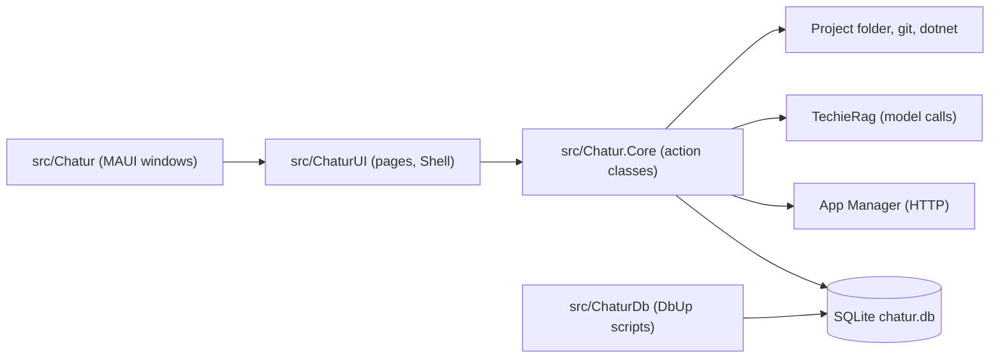

A page never opens the database. It calls one interface from `src/Chatur.Core/Actions`, and the class behind it runs Dapper SQL through `IDbConnectionFactory`. There is no separate data-access layer: the SQL sits inside each action class.

| Layer | Project or folder | What lives here |
|---|---|---|
| Host | `src/Chatur` | `MauiProgram.cs` (services, logging, migration), `Services/WindowService.cs`, `Windows/*.xaml`, `Platform/*` (secret store, paths, process launcher) |
| Pages | `src/ChaturUI/Pages`, `Pages/Settings` | One `.razor` plus `.razor.cs` per screen |
| Main window parts | `src/ChaturUI/Shell` | `MenuBar`, `AppToolbar`, `FilesPanel`, `EditorArea`, `ConversationPanel`, `OutputStrip`, `WorkbenchState` |
| Layouts | `src/ChaturUI/Layouts` | `BareLayout`, `StartLayout`, `MainLayout`, `SecondaryLayout`, `AuthGate` |
| Action interfaces | `src/Chatur.Core/Actions` | `I*Actions` and the records they return |
| Action classes | `src/Chatur.Core/<Area>` | `AccountActions`, `ProjectActions`, `AgentActions`, `BuildRunActions` and the rest, registered in `ServiceCollectionExtensions.cs:40` |
| Shared state | `src/Chatur.Core/AppState.cs` | Selected project, signed-in user, theme; one instance for the whole app |
| Database | `src/ChaturDb/Scripts` | Numbered `.sql` files, run by `ChaturDbMigrator.Migrate` at start-up |

Naming used in the code: `obj` for fields, `v` for locals, `a` for parameters. The watch names in this guide follow it.

## Roles and menu map

Chatur has one role. Every signed-in person sees every menu.

| Role | Test user | Menu items and the screen each opens |
|---|---|---|
| User | 1: `chatur-owner@techierathore.com` | All menus below |
| User | 2: `chatur-second@…` | Same |
| User | 3: `chatur-yolo-tester@…` | Same |

The main window's menus are in `src/ChaturUI/Shell/MenuBar.razor`. An item marked "secondary window" calls `MenuBar.razor.cs:78` `OpenSecondary`, which calls `ISecondaryWindow.Open`.

| Menu | Item | What it opens |
|---|---|---|
| File | New project, Open a solution, Open a folder, Clone a repository | `OpenProjectDialog`, then the main window (`/`) |
| File | Recent projects ▸ a project | Switches project in place (`SwitchToAsync`) |
| File | Recent projects ▸ Project list | Start window list (`/start?all=1`) |
| File | Save, Save all | Writes the open file or files; no screen |
| File | Close project | Clears the selection, then `/start?all=1` |
| File | Exit | `IAppShell.Exit` |
| Edit | Undo, Redo, Cut, Copy, Paste | Act on the open file's editor |
| Edit | Find in files, Go to file | `FileSearchDialog` |
| View | Files, Chat, Output | Show or hide that part of the main window |
| View | Prerequisites | Secondary window, `/prerequisites` |
| View | Repository | Secondary window, `/repository` |
| View | Appearance | Secondary window, `/settings/appearance` |
| View | Zoom ▸ Zoom in, Zoom out, Actual size | `IAppShell.ZoomBy`, `ResetZoom` |
| Project | Build, Run, Stop, Run target | Same commands as the toolbar; output goes to the output strip |
| Project | Prerequisites, Repository | Secondary window |
| Project | Processes, Board, Agent workspace, End-to-end run, Run queue, Run record | Tabs in the main window; built in later phases |
| Tools | Settings (Ctrl+,) | Secondary window, `/settings/providers` |
| Tools | Model providers, Routing, Agents, Corrections, Measurements, Appearance | Secondary window, the matching `/settings/...` page |
| Help | About Chatur | A dialog with version and commit |
| Help | Send feedback | Secondary window, `/feedback` |
| Help | Check for updates | Secondary window, `/prerequisites` |

Two more menus sit in the same bar. The project switcher (`MenuBar.razor:9`) lists other projects and ends with "All projects", which goes to `/start?all=1`, not to `/all-projects`. The account menu (`Shell/AccountMenu.razor:20` to `:24`) opens Account (`/settings/account`), Licence (`/licence`), Settings (`/settings/providers`) and Sign out.

The secondary window's own list comes from `src/ChaturUI/Layouts/SecondaryNavigation.cs:11`: Prerequisites, Repository, Model providers, Routing, Agents, Corrections, Measurements, Appearance, Account, Licence, Feedback, Working copies, All projects, Integrations. Working copies, All projects and Integrations can only be reached from this list.

## Screen-by-screen code map

### Sign in (`/sign-in`)

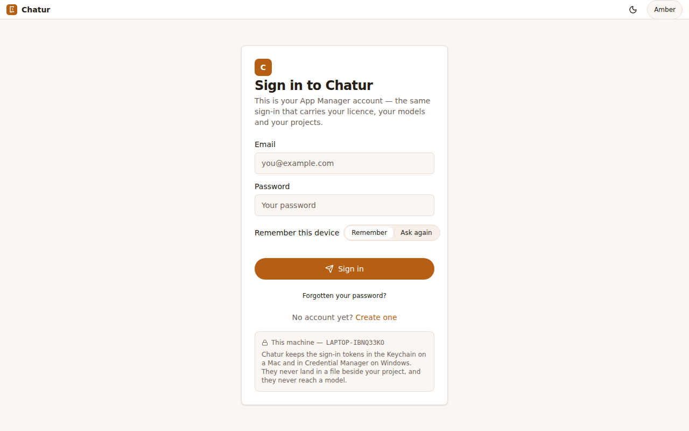

**Call chain:** `SignIn.razor.cs:HandleSignInAsync` → `AccountActions.SignInAsync` → `AppManagerClient.DeviceLoginAsync` → `POST AuthSvc/device-login`, then the secret store and table `Installation`

The page uses `BareLayout`, so no sign-in check runs here. The form at `SignIn.razor:25` submits to `HandleSignInAsync`. The action reads this machine's device id (created once, table `Installation`), fetches App Manager's public key, encrypts the password and posts it. On success it saves the session to the secret store when "remember" is ticked, sets `AppState.CurrentUser` and the page goes to `/start`.

On refusal the page shows App Manager's own message in `objErrorMessage`. Any exception inside the action is caught at `AccountActions.cs:90`, logged, and returned as "Could not reach App Manager". An empty `AppManager:BaseUrl` ends there too, so check the log file before the network. "Forgotten your password?" (`SignIn.razor.cs:68`) only shows a toast; it calls nothing.

| File and line | Function | Watch | Expected value |
|---|---|---|---|
| `src/ChaturUI/Pages/SignIn.razor.cs:48` | `HandleSignInAsync` | `vResult.Succeeded` | `true`; the next line goes to `/start` |
| `src/Chatur.Core/Accounts/AccountActions.cs:69` | `SignInAsync` | `vDeviceId` | 32 hex characters, the same on every run |
| `src/Chatur.Core/Accounts/AccountActions.cs:74` | `SignInAsync` | `vResult.Success`, `vResult.ErrorMessage` | `true` and `null`; a wrong password gives `false` and the server's text |
| `src/Chatur.Core/Accounts/AppManagerClient.cs:121` | `PostAuthAsync` | `vResponse.StatusCode`, `vEnvelope.Message` | 200 and an envelope whose `Data` holds both tokens |
| `src/Chatur.Core/Accounts/AccountActions.cs:254` | `PersistSessionAsync` | `aRemember` | `true`; six `AppManager.*` names are then saved |

**Calculations on this screen:** none. `AccountActions.EncryptPassword` (`AccountActions.cs:289`) encrypts the password with the server's public key (RSA, OAEP SHA-256) before it leaves the machine.

### Register (`/register`)

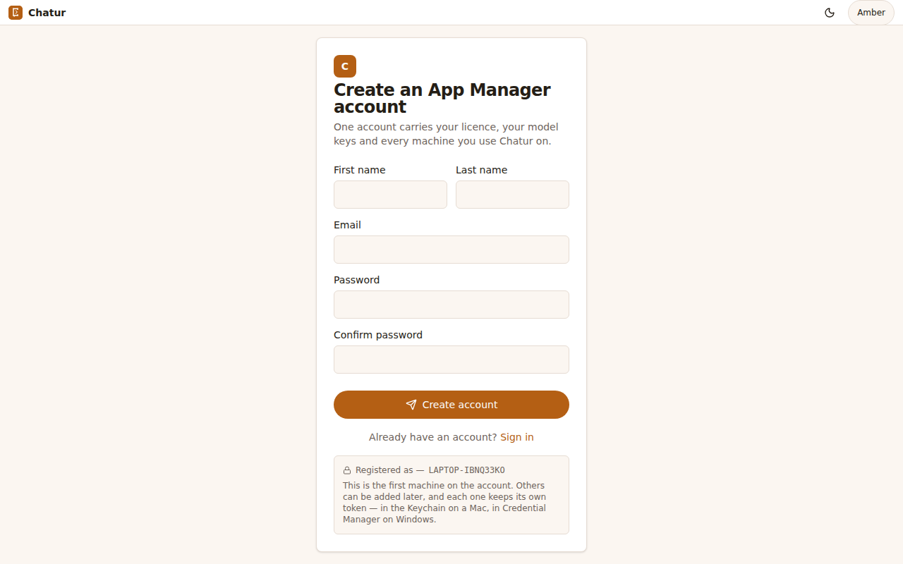

**Call chain:** `Register.razor.cs:HandleSubmitAsync` → `AccountActions.RegisterAsync` → `AppManagerClient.DeviceRegisterAsync` → `POST AuthSvc/device-register`, then the secret store

The page also uses `BareLayout`. "Create account" (`Register.razor:95`) runs `HandleSubmitAsync`. It checks the password rule first and stops without sending when the rule fails, then checks that both password boxes match. Only then does it build a `RegisterRequest` and call the action.

`RegisterAsync` checks the same rule again, so a caller that skips the page still gets a refusal. It uses the same device id, public key and encryption as sign-in. On success it always saves the session (`aRemember: true` at `AccountActions.cs:137`) and the page goes to `/start`.

One thing to know when debugging: the page sets `objEmailInUse = true` on every refusal (`Register.razor.cs:89`), including "Could not reach App Manager". The email box is marked even when the email was not the problem.

| File and line | Function | Watch | Expected value |
|---|---|---|---|
| `src/ChaturUI/Pages/Register.razor.cs:60` | `HandleSubmitAsync` | `PasswordRule.Evaluate(objPassword).MeetsRule` | `true`; `false` sets `objPasswordInvalid` and returns |
| `src/ChaturUI/Pages/Register.razor.cs:78` | `HandleSubmitAsync` | `vResult.Succeeded`, `vResult.ErrorMessage` | `true` and `null` |
| `src/Chatur.Core/Accounts/PasswordRule.cs:23` | `Evaluate` | `vHasLength`, `vHasCapital`, `vHasNumber`, `vHasSpecial` | all `true` for a password the server accepts |
| `src/Chatur.Core/Accounts/AccountActions.cs:124` | `RegisterAsync` | `vResult.Success`, `vResult.UserId` | `true` and a number |
| `src/Chatur.Core/Accounts/AppManagerClient.cs:92` | `DeviceRegisterAsync` | `vBody` | email, encryptedPassword, firstName, lastName, deviceInfo; `applicationId` only when no API key header is set |

**Calculations on this screen:** `RuleMetCount` (`Register.razor.cs:36`) counts how many of the four rule parts are met, for the live list under the password box. `PasswordsMatch` (`:41`) is true when the confirm box is not empty and equals the password. `PasswordRule.Evaluate` works out the four parts: eight or more characters, a capital, a digit, and one character from `SpecialCharacters` (`PasswordRule.cs:13`).

### Start window (`/start`)

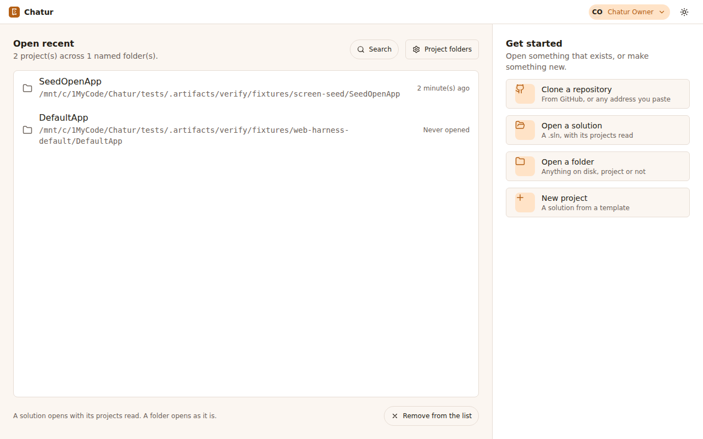

**Call chain:** `Start.razor.cs:OpenProjectAsync` → `ProjectActions.SelectProjectAsync` → tables `Project` (`LastOpenedUtc`) and `Setting` (key `SelectedProjectId`)

`StartLayout` wraps the page in `AuthGate`, so a person who is not signed in is sent to `/sign-in`. On load the page asks which project was selected last. If there is one, it goes straight to `/` unless the address carries `?all=1`. Otherwise `ReloadAsync` lists the named folders and scans them.

`ScanAsync` looks one level into each named folder. A sub-folder with a `.sln` file becomes a project of kind `Solution` whose `Path` is the `.sln` file itself; any other sub-folder becomes kind `Folder`. New ones are inserted into `Project`; rows with `RemovedUtc` set are left out of the list.

"Project folders" opens `ProjectFoldersDialog`, which calls `AddFolderAsync` and `RemoveFolderAsync`. The four ways in (clone, open a solution, open a folder, new project) open `Shell/OpenProjectDialog`, which calls `ProjectOpenActions` and then goes to `/`. The remove button on a row calls `ForgetProjectAsync`, which sets `RemovedUtc` and deletes nothing on disk.

| File and line | Function | Watch | Expected value |
|---|---|---|---|
| `src/ChaturUI/Pages/Start.razor.cs:65` | `OnInitializedAsync` | `vSelectedProject`, `ShowAll` | `null` on a first run; otherwise the page leaves for `/` |
| `src/ChaturUI/Pages/Start.razor.cs:86` | `ReloadAsync` | `objProjects.Count` | the number of rows drawn in the list |
| `src/Chatur.Core/Projects/ProjectActions.cs:178` | `ScanAsync` | `vCandidate` | name, path and kind of one sub-folder |
| `src/Chatur.Core/Projects/ProjectActions.cs:331` | `SelectProjectAsync` | `vRow` | the `Project` row; `null` throws `InvalidOperationException` |
| `src/Chatur.Core/Projects/ProjectActions.cs:364` | `SelectProjectAsync` | `objAppState.SelectedProject` | the chosen project with the new `LastOpenedUtc` |

**Calculations on this screen:** `FormatWhen` (`Start.razor.cs:138`) turns the last-opened time into "just now", minutes, hours or days ago, or a date after 30 days. `VisibleProjects` (`:37`) filters the list by the search text against name and path. `ProjectActions.FindCandidates` (`ProjectActions.cs:222`) decides the kind of each sub-folder.

### Main window (`/`)

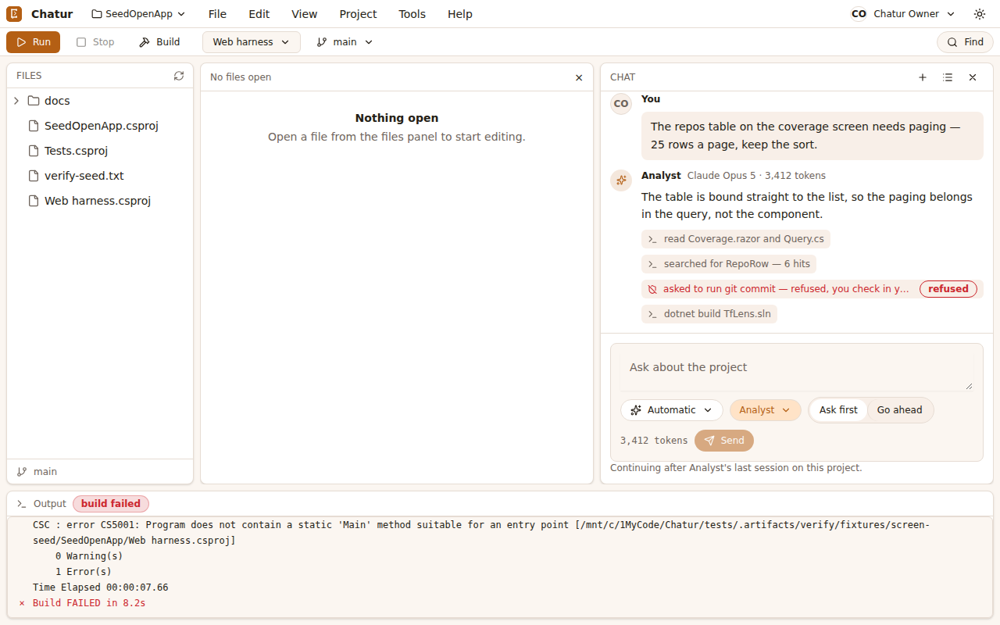

**Call chain:** `ConversationPanel.razor.cs:SendMessageAsync` → `AgentActions.SendAsync` → tables `SessionEvent`, `Session` and `Change`

This is the Workbench. `Pages/Workbench.razor` holds only `FilesPanel`, `EditorArea` and `ConversationPanel`. `Layouts/MainLayout.razor` adds `MenuBar` (line 85), `AppToolbar` (86), the sign-in check (87) and `OutputStrip` (95). The parts do not call each other. They share `WorkbenchState` (`Shell/WorkbenchState.cs`), which holds open tabs, the active tab, which parts are visible, the run targets and the busy flag, and raises `Changed`.

What each part does:

- `MenuBar`: menus, project switcher, account menu, Ctrl+, shortcut.
- `AppToolbar`: branch name and switch, run target, Build, Run, Stop.
- `FilesPanel`: file tree from `FileActions.TreeAsync`; a click reads the file and opens a tab.
- `EditorArea`: tabs and the editor; save writes through `FileActions.SaveAsync`.
- `ConversationPanel`: sessions, messages, agent and model pick, proposed changes.
- `OutputStrip`: build and run lines, with a list of compiler errors that open the file.

`Workbench.razor.cs:45` listens to `AppState.Changed` and calls `WorkbenchTabs.Reset()` when the project id changes, so tabs from the old project close. The agent loop and the output stream are described under Cross-cutting flows.

| File and line | Function | Watch | Expected value |
|---|---|---|---|
| `src/ChaturUI/Shell/MenuBar.razor.cs:294` | `SwitchToAsync` | `aProjectId` | the id picked in the switcher |
| `src/ChaturUI/Shell/AppToolbar.razor.cs:164` | `BuildAsync` | `objSelectedTarget.RunTargetId`, `Workbench.IsBuildRunBusy` | the chosen target; `true` |
| `src/ChaturUI/Shell/FilesPanel.razor.cs:121` | `OnSelectedPathChangedAsync` | `aPath`, `vContent` | a path with forward slashes, relative to the project; the file's text |
| `src/ChaturUI/Shell/EditorArea.razor.cs:87` | `SaveActiveAsync` | `vFile.RelativePath`, `vFile.IsDirty` | the open file; `true` before, `false` after `MarkSaved` |
| `src/ChaturUI/Shell/ConversationPanel.razor.cs:759` | `SendMessageAsync` | `vChunk.TextDelta`, `vChunk.IsFinal` | pieces of text; the last chunk has `IsFinal` true, a model name and a token count |
| `src/ChaturUI/Shell/OutputStrip.razor.cs:115` | `ConsumeOutputAsync` | `vLine.Text`, `objStatusText` | each output line; "running", "build passed", "build failed" or "stopped" |

**Calculations on this screen:** `OutputStrip.ParseError` (`OutputStrip.razor.cs:184`) turns a compiler error line into file, line number and message. `ConversationPanel.LoadTotalTokensAsync` (`:494`) sums the tokens of every recorded event in the session. `MenuBar.LoadRecentAsync` (`MenuBar.razor.cs:196`) picks the five most recently opened projects.

### Prerequisites (`/prerequisites`)

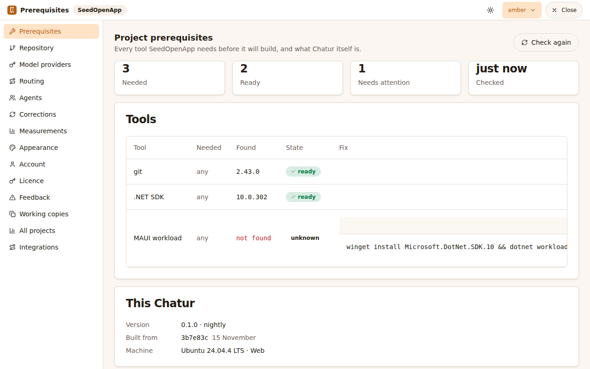

**Call chain:** `Prerequisites.razor.cs:LoadAsync` → `PrerequisiteActions.ProbeAsync` → `ProcessCommandRunner.RunAsync` (one version command per tool); table `Project` gives the folder

The page does three reads in `LoadAsync`. First the tools: with a project selected, `ResolveProjectCatalogAsync` reads the project's folder and looks at what is in it to decide which tools to list; with none, it uses `ToolProbeCatalog.Default`. Each tool's version command is run. A command that does not start is `Missing` and gets a fix command to copy (the Mac one on macOS, the Windows one elsewhere). A command that starts but prints no version that can be read is `Unknown`.

Second, Chatur's own version and commit, read from the `Chatur.Core` assembly's attributes. Third, after the page is already drawn, the newer-build check: `GitHubReleaseClient.LatestReleaseAsync` asks the release feed (15 second limit, set in `ServiceCollectionExtensions.cs:84`) and `NightlyRelease.EvaluateOffer` decides whether to offer it. A feed that fails or answers 404 gives no offer and one log line.

"Check again" runs `LoadAsync` again. Help ▸ About Chatur in the main window shows the same version and commit.

| File and line | Function | Watch | Expected value |
|---|---|---|---|
| `src/ChaturUI/Pages/Prerequisites.razor.cs:47` | `LoadAsync` | `objTools` | a list; `null` shows the empty state |
| `src/Chatur.Core/Prerequisites/PrerequisiteActions.cs:56` | `ProbeAsync` | `vResult.Started`, `vResult.StandardOutput` | `true` and the tool's version text |
| `src/Chatur.Core/Prerequisites/PrerequisiteActions.cs:101` | `ResolveProjectCatalogAsync` | `vSignals` | what was found in the project folder |
| `src/Chatur.Core/Prerequisites/PrerequisiteActions.cs:239` | `ReadOwnBuildInfo` | `vVersion`, `vCommit` | for example `0.1.0-nightly` and a commit; `unknown` when the build did not stamp one |
| `src/Chatur.Core/Prerequisites/GitHubReleaseClient.cs:36` | `LatestReleaseAsync` | `vResponse.StatusCode` | 200 |
| `src/Chatur.Core/Prerequisites/NightlyRelease.cs:74` | `EvaluateOffer` | `vIsNewerVersion`, `vIsSameVersionNewerCommit` | both `false` means no offer |

**Calculations on this screen:** `ReadyCount` and `AttentionCount` (`Prerequisites.razor.cs:24`, `:26`) count ready tools and the rest. `DisplayVersion` (`:112`) splits `0.1.0-nightly` into "0.1.0 · nightly". `ShortCommit` (`:118`) keeps seven characters. `NightlyRelease.EvaluateOffer` offers a build when its version is higher, or when the version is equal, the commit differs and it was published after this build was made.

### Repository (`/repository`)

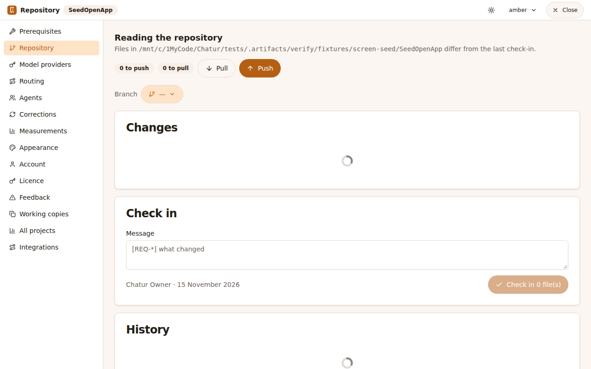

**Call chain:** `Repository.razor.cs:CheckInChosenAsync` → `SourceControlActions.CheckInAsync` → `SourceControlActions.RunGitAsync` (`git add`, `git commit` in the project folder; table `Project` gives the folder)

Every read and write on this page is a `git` process started by `RunGitAsync` (`SourceControlActions.cs:573`). Nothing about the repository is kept in Chatur's database. `ResolveWorkingDirectoryAsync` (`:433`) reads `Project.Path` and, when that is a `.sln` file, uses its folder.

`LoadAsync` first asks `IsRepositoryAsync`. A folder without a repository shows a plain message and stops. Otherwise four reads start side by side: changed files, branch status, branch list and history. The first changed file's difference is shown at once.

`StatusAsync` runs `git fetch --quiet` before it counts, so the page needs the network to show true ahead and behind numbers, and is slow when the remote is slow. A repository with no upstream gives 0 and 0.

Check in is enabled by `CanCheckIn`: a project, not busy, at least one chosen file and a message. Push and Pull run plain `git push` and `git pull` and then read the status again. A failed git command throws from `EnsureSuccess` with git's own error text, which the page shows in a toast.

| File and line | Function | Watch | Expected value |
|---|---|---|---|
| `src/ChaturUI/Pages/Repository.razor.cs:82` | `LoadAsync` | `objIsRepository` | `true` |
| `src/ChaturUI/Pages/Repository.razor.cs:96` | `LoadAsync` | `objChanges.Count` | the number of changed files |
| `src/ChaturUI/Pages/Repository.razor.cs:295` | `CheckInChosenAsync` | `vPaths`, `objCheckInMessage` | the chosen paths; a message that is not empty |
| `src/Chatur.Core/SourceControl/SourceControlActions.cs:146` | `CheckInAsync` | `vCommitResult.ExitCode` | 0 |
| `src/Chatur.Core/SourceControl/SourceControlActions.cs:191` | `StatusAsync` | `vParts` | two numbers: behind first, then ahead |
| `src/Chatur.Core/SourceControl/SourceControlActions.cs:593` | `RunGitAsync` | `aArguments`, `vProcess.ExitCode` | the git arguments; 0 |

**Calculations on this screen:** `SourceControlActions.ChangesAsync` (`:58`) works out lines added and removed per file from `git diff HEAD --numstat`; a new file counts all its lines as added. `StatusAsync` (`:172`) works out ahead and behind. On the page, `CanCheckIn` (`Repository.razor.cs:46`), `NumberOf` (`:179`, `:199`), `RequirementRange` (`:214`) and `FormatWhen` (`:223`) shape what is shown.

### Settings ▸ Model providers (`/settings/providers`)

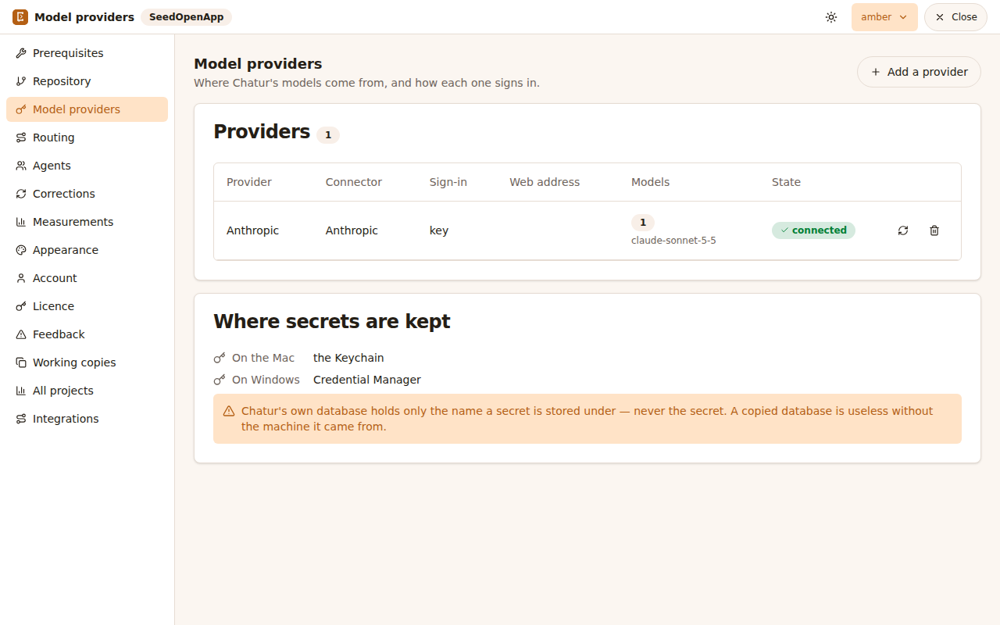

**Call chain:** `SettingsProviders.razor.cs:TestAsync` → `ProviderActions.TestAsync` → `TechieRagConnectionProbe.ProbeAsync` → table `Provider` (`State`)

The page lists rows from `Provider` and their models from `Model`. Test reads the provider's key from the secret store by `SecretName`, calls the service once and writes `Connected` or `Failed` back to `Provider.State`. A provider signed in through the browser is not called: it passes when a stored session exists. Remove deletes the provider's `Model` rows, the `Provider` row and then the secret.

The "Add a provider" button opens `AddProviderDialog`. Its own chain is `AddProviderDialog.razor.cs:AddAsync` → `ProviderActions.AddWithKeyAsync`, `AddLocalAsync` or `AddSubscriptionAsync` → tables `Provider` and `Model`. Which one runs depends on the sign-in choice: pasted key, no sign-in (a local service), or the browser. For a pasted key the row is inserted first, the key is saved in the secret store as `chatur.provider.{id}`, and only that name is written to the row. The key itself never goes into the database. For an OpenAI-compatible service the model list is read from the service before anything is saved; if that read fails, nothing is added. The dialog's Test button calls `TestUnsavedAsync`, which probes without saving.

| File and line | Function | Watch | Expected value |
|---|---|---|---|
| `src/ChaturUI/Pages/Settings/SettingsProviders.razor.cs:29` | `LoadAsync` | `objProviders`, `objModels` | lists; `null` shows "no providers yet" |
| `src/ChaturUI/Pages/Settings/SettingsProviders.razor.cs:51` | `TestAsync` | `vResult.Succeeded`, `vResult.Message` | `true` and `null` |
| `src/Chatur.Core/Models/ProviderActions.cs:250` | `TestAsync` | `vRow.SignInMethod`, `vSecret` | the row's method; a key that is not empty |
| `src/Chatur.Core/Models/TechieRagConnectionProbe.cs:71` | `ProbeAsync` | `vLlm.ModelName` | the connector's default model |
| `src/ChaturUI/Pages/Settings/AddProviderDialog.razor.cs:217` | `AddAsync` | `SignIn`, `objConnector` | `key`, `browser` or `none`; the connector chosen |
| `src/Chatur.Core/Models/ProviderActions.cs:108` | `AddWithKeyAsync` | `vSecretName` | `chatur.provider.` followed by the new id |

**Calculations on this screen:** `NamesOf` (`SettingsProviders.razor.cs:90`) shows the first three model names and "+N more". `ModelsOf` (`:41`) picks one provider's models. In the dialog, `MinutesLeft` (`AddProviderDialog.razor.cs:118`) works out how long the browser sign-in code is still good for.

### Settings ▸ Routing (`/settings/routing`)

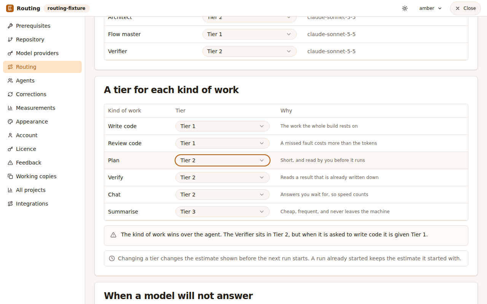

**Call chain:** `SettingsRouting.razor.cs:WriteChainAsync` → `RoutingActions.ReorderChainAsync` → table `RoutingSetting` (keys `Tier1Chain`, `Tier2Chain`, `Tier3Chain`)

Routing decides which model answers. There are three tiers. Each tier has an ordered list of model ids, stored as a JSON array in one `RoutingSetting` row. Add, remove and move on the page all build a new list in memory and send the whole list through `WriteChainAsync`. The action refuses a list that names a model id not in `Model`.

On load the page calls `EnsureShippedTiersAsync`. The first time there are models and no `TiersInitialised` row, it fills the three lists from each model's own `Tier` and marks it done. "Reset" does the same at any time.

Other controls on the page:

- A tier for each agent writes `Role.Tier` (`SetRoleTierAsync`). The Agents page edits the same column.
- A tier for each kind of work writes `RoutingEntry` (`SetWorkTierAsync`). The six kinds and their starting tiers are the `WorkKinds` list at `SettingsRouting.razor.cs:16`.
- The number of failed fixes before work moves up a tier writes `RoutingSetting` key `EscalationThreshold`. The seed value is 3 (`0002-SeedRoles.sql:48`).
- The automatic routing switch writes `RoutingSetting` key `AutoRouting`.

Every change is saved at once; there is no Save button. `AgentActions.BuildFallbackChainAsync` reads these lists when a message is sent.

| File and line | Function | Watch | Expected value |
|---|---|---|---|
| `src/ChaturUI/Pages/Settings/SettingsRouting.razor.cs:67` | `LoadAsync` | `objTiers` | three items, each with `ModelIdsInOrder` |
| `src/ChaturUI/Pages/Settings/SettingsRouting.razor.cs:124` | `MoveAsync` | `vChain` | the same ids with two neighbours swapped |
| `src/Chatur.Core/Routing/RoutingActions.cs:88` | `ReorderChainAsync` | `vFound` | equal to `aModelIdsInOrder.Count`; otherwise `ArgumentException` |
| `src/Chatur.Core/Routing/RoutingActions.cs:94` | `ReorderChainAsync` | `vJson` | a JSON array of ids such as `[3,1]` |
| `src/Chatur.Core/Routing/RoutingActions.cs:60` | `SetRoleTierAsync` | `vAffected` | 1 |

**Calculations on this screen:** `FirstModelOf` (`SettingsRouting.razor.cs:81`) names the first model of an agent's tier, or a dash when the list is empty. `AvailableModels` (`:89`) is every model not already in a tier's list. `CountText` (`:190`) writes "1 model" or "N models".

### Settings ▸ Agents (`/settings/agents`)

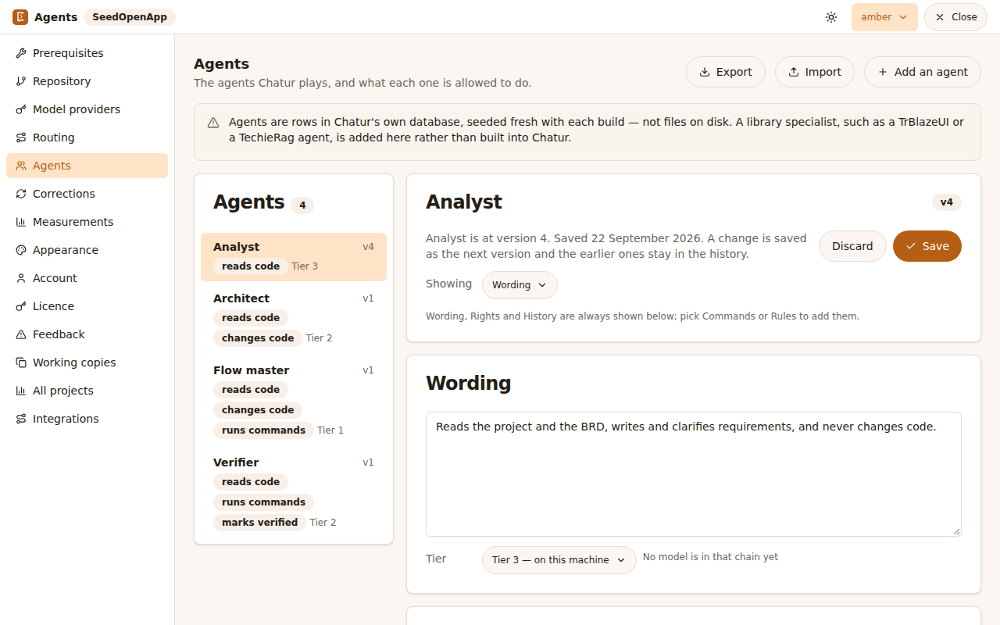

**Call chain:** `SettingsAgents.razor.cs:SaveAsync` → `RoleActions.SaveAsync` → tables `Role`, `RoleCommand`, `Rule` and `RoleVersionHistory`

In the code an agent is a role. The page loads every role, then the detail of each one (`ReloadAsync`), and selects the first. The detail holds the wording, the rights, the commands, the rules and the version history. Editing fills four draft fields; nothing is written until Save.

`SaveAsync` splits the commands and rules boxes into lines and calls the action. The action refuses wording shorter than 40 characters. It then raises `Role.Version` by one, replaces the role's `RoleCommand` rows, replaces the `Rule` rows whose `Scope` is the role's code, and adds a `RoleVersionHistory` row. These statements run one after another with no transaction (`RoleActions.cs:262` to `:293`), so a failure part-way leaves the earlier ones in place. If the tier draft changed, a second call (`SetTierAsync`) writes `Role.Tier`.

Restore in the history list saves an old version's wording as the next version; it does not go back. "Add an agent" opens `AddAgentDialog`, which calls `RoleActions.AddAsync` with tier 2 and the right to read files, plus edit and build when ticked. Export downloads `RoleActions.ExportAsync` as a JSON file; import reads a chosen file and calls `ImportAsync`.

| File and line | Function | Watch | Expected value |
|---|---|---|---|
| `src/ChaturUI/Pages/Settings/SettingsAgents.razor.cs:75` | `ReloadAsync` | `objDetails.Count` | one entry per role |
| `src/ChaturUI/Pages/Settings/SettingsAgents.razor.cs:116` | `SaveAsync` | `objWordingDraft`, `vCommands`, `vRules` | the text in the three boxes |
| `src/Chatur.Core/Roles/RoleActions.cs:241` | `SaveAsync` | `aWording.Length` | 40 or more; less throws `ArgumentException` |
| `src/Chatur.Core/Roles/RoleActions.cs:259` | `SaveAsync` | `vNewVersion` | the current version plus one |
| `src/ChaturUI/Pages/Settings/AddAgentDialog.razor.cs:60` | `AddAsync` | `vActions` | `read-file`, plus `edit-file` and `run-build` when ticked |

**Calculations on this screen:** `VersionOf` (`SettingsAgents.razor.cs:249`) takes the highest version in a role's history. `PillsOf` (`:253`) turns rights into the labels "reads code", "changes code", "runs commands" and "marks verified". `SavedLine` (`:290`) builds the sentence about the current version and when it was saved.

### Settings ▸ Corrections (`/settings/corrections`)

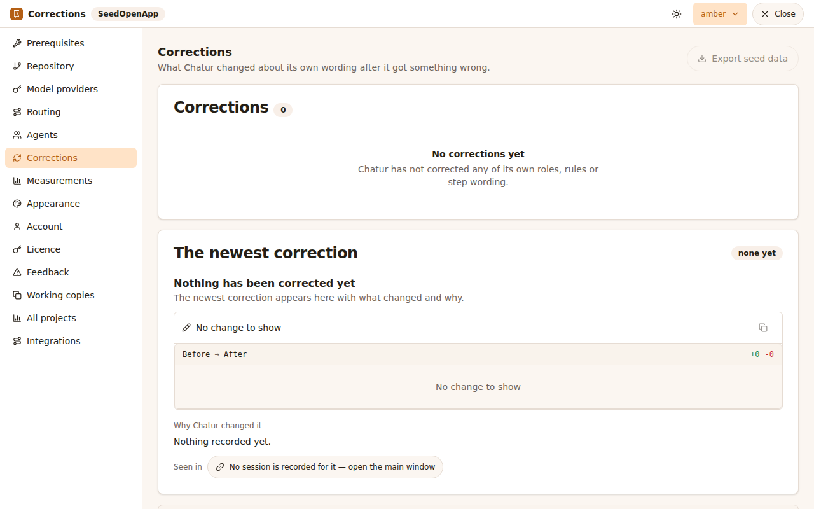

**Call chain:** `SettingsCorrections.razor.cs:UndoAsync` → `CorrectionActions.UndoAsync` → table `Correction`, then `Rule`, `ProcessStepText`, or `Role` with `RoleVersionHistory`

A correction is a change an agent made to wording: an agent's own wording, a rule, or a process step's text. Rows are not created on this page. They come from the agent tool `CorrectWording` (`AgentActions.cs:1098`), which calls `CorrectionActions.CorrectWordingAsync` (`CorrectionActions.cs:52`). That method changes the wording and inserts the `Correction` row with the text before and after and the reason.

The page lists them newest first and shows the difference for the chosen one. `SelectedCorrection` falls back to the first row when nothing is chosen.

- Keep sets `Status` to `Kept`.
- Undo sets `Status` to `Undone` and puts the `Before` text back. The `Target` decides where: `rule:` plus an id updates `Rule`, `step:` updates `ProcessStepText`, anything else is a role code and writes a new role version. When `Before` is empty only the status changes.
- "Export seed data" downloads every kept correction as JSON.
- "Copy" puts the changed lines on the clipboard, each with a leading plus or minus.

The `catch (NotImplementedException)` blocks on this page are left from an earlier build; the three actions are built.

| File and line | Function | Watch | Expected value |
|---|---|---|---|
| `src/ChaturUI/Pages/Settings/SettingsCorrections.razor.cs:24` | `LoadAsync` | `objCorrections` | every row, newest first |
| `src/ChaturUI/Pages/Settings/SettingsCorrections.razor.cs:45` | `UndoAsync` | `aCorrection.CorrectionId`, `aCorrection.Target` | the row clicked |
| `src/Chatur.Core/Corrections/CorrectionActions.cs:218` | `UndoAsync` | `vCorrection.Target`, `vCorrection.Before` | `rule:` and an id, `step:` and a code, or a role code; the earlier text |
| `src/Chatur.Core/Corrections/CorrectionActions.cs:186` | `KeepAsync` | `vAffected` | 1; 0 throws `KeyNotFoundException` |
| `src/Chatur.Core/Corrections/CorrectionActions.cs:287` | `ExportSeedAsync` | `vKept.Count` | the number of rows with `Status` `Kept` |

**Calculations on this screen:** `CopyDiffAsync` (`SettingsCorrections.razor.cs:70`) compares before and after with `TextDiff.Compare` and keeps only added and removed lines. `KindOf` (`:91`) reads the kind from the start of `Target`.

### Settings ▸ Measurements (`/settings/measurements`)

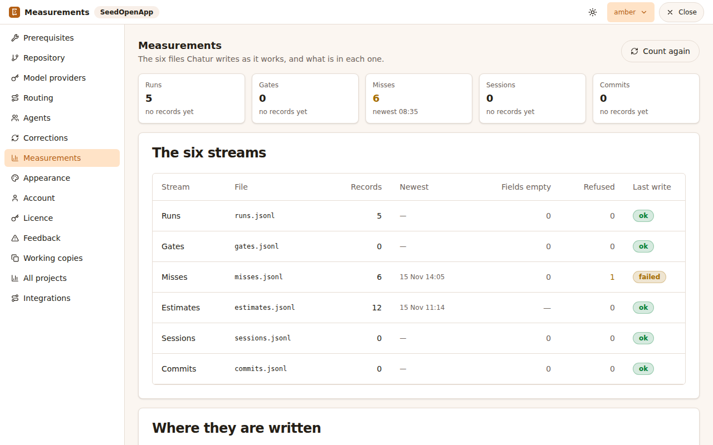

**Call chain:** `SettingsMeasurements.razor.cs:LoadAsync` → `MeasurementActions.StreamsAsync` → files `docs/metrics/*.jsonl` in the project folder and table `RefusedWrite`

The numbers on this page are not in Chatur's database. They are counted from six files in the selected project's `docs/metrics` folder: `runs.jsonl`, `gates.jsonl`, `misses.jsonl`, `estimates.jsonl`, `sessions.jsonl` and `commits.jsonl` (`MeasurementActions.cs:18`). Each line of a file is one record. With no project selected the page shows nothing.

For each file `StreamsAsync` counts the lines, counts fields that are null or empty, and finds the newest date. It then reads `RefusedWrite` for that project and file. A write is refused when a record fails `MeasurementSchema.TryValidate` or the file cannot be written; `AppendAsync` (`:196`) records the reason there instead of throwing. `FolderAsync` gives the folder path and the last line of `runs.jsonl`, indented for reading.

The lower panel lists other project folders used for estimates. It calls `EstimateActions.SistersAsync`, `AddSisterAsync` and `RemoveSisterAsync` against table `SisterProject`. A refused folder shows the action's own reason.

Watch one thing: `StreamsAsync`, `FolderAsync` and `AppendAsync` join `Project.Path` with `docs/metrics` as it is. For a project of kind `Solution` that path is the `.sln` file (`ProjectActions.cs:259`), and these methods do not take its folder the way `FileActions.cs:63` does. If counts are all zero for a solution, look at `vFilePath` first.

| File and line | Function | Watch | Expected value |
|---|---|---|---|
| `src/ChaturUI/Pages/Settings/SettingsMeasurements.razor.cs:38` | `LoadAsync` | `objStreams.Count` | 6 |
| `src/Chatur.Core/Measurements/MeasurementActions.cs:63` | `StreamsAsync` | `vFilePath` | a real file under the project's `docs/metrics` |
| `src/Chatur.Core/Measurements/MeasurementActions.cs:94` | `StreamsAsync` | `vLastWriteFailed` | `true` only when the newest refused write is later than the newest record |
| `src/Chatur.Core/Measurements/MeasurementActions.cs:220` | `AppendAsync` | `vRefusalReason` | `null` for a record that is accepted |
| `src/Chatur.Core/Estimates/EstimateActions.cs:179` | `SistersAsync` | the returned list | one item per `SisterProject` row |

**Calculations on this screen:** `StreamsAsync` (`MeasurementActions.cs:45`) works out record count, empty-field count (`CountEmptyFields`, `:145`), newest date (`TryReadAt`, `:165`), refused-write count and whether the last write failed. On the page, `SisterCountText` (`SettingsMeasurements.razor.cs:49`) and `FailedStreamsText` (`:100`) build two short texts.

### Settings ▸ Appearance (`/settings/appearance`)

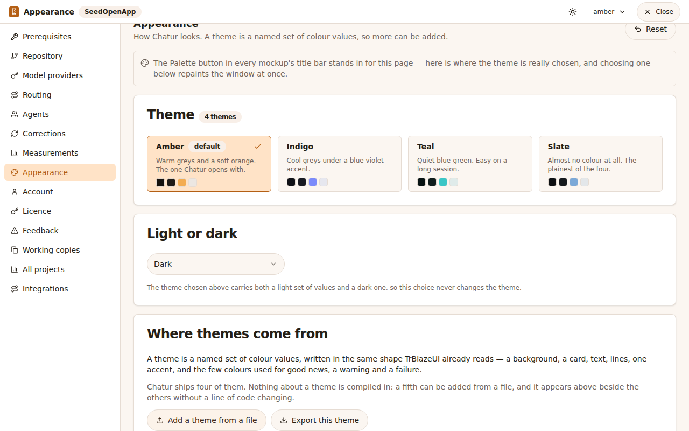

**Call chain:** `SettingsAppearance.razor.cs:ChooseAsync` → `ThemeActions.ChooseAsync` → table `Theme` (the name must exist) and table `Setting` (keys `Appearance.ThemeName`, `Appearance.ThemeMode`, `Appearance.IsDark`)

The page lists rows from `Theme`. Four ship with Chatur (amber, indigo, teal, slate); others have `Source` equal to `file`. Each row's `Values` column is JSON with a `light` and a `dark` set of colours.

Choosing a theme, changing the mode (light, dark, follow the system) and Reset all go through `ThemeActions.ChooseAsync`. It checks the name, writes the three `Setting` rows and calls `AppState.SetTheme`. The page itself paints nothing. `Shell/ThemeHost`, which sits in `ChaturRoutes.razor:25` in every window, hears `AppState.Changed` and applies the theme through `ThemeInterop`. That is why every open window changes together.

"Add a theme from a file" takes a typed file path. `AddFromFileAsync` uses the file name as the theme name, checks the JSON shape, refuses a name that already exists and inserts the row. `ArgumentException`, `InvalidOperationException` and `FileNotFoundException` are shown in the dialog (`objAddError`); anything else is not caught here. Export downloads the chosen theme in the same shape.

| File and line | Function | Watch | Expected value |
|---|---|---|---|
| `src/ChaturUI/Pages/Settings/SettingsAppearance.razor.cs:81` | `ChooseAsync` | `aThemeName`, `State.ThemeMode` | the card clicked; the mode already in use |
| `src/Chatur.Core/Themes/ThemeActions.cs:77` | `ChooseAsync` | `vExists` | a theme id; `null` throws `KeyNotFoundException` |
| `src/Chatur.Core/Themes/ThemeActions.cs:89` | `ChooseAsync` | `objAppState.ThemeName` | the new name after this line |
| `src/ChaturUI/Shell/ThemeHost.razor.cs:86` | `ApplyAsync` | `vTheme.Source`, `vIsDark` | `file` takes the custom path; anything else calls `SetThemeAsync` |
| `src/Chatur.Core/Themes/ThemeActions.cs:106` | `AddFromFileAsync` | `vName`, `vJson` | a name made from the file name; JSON with both sets |

**Calculations on this screen:** `SwatchColours` (`SettingsAppearance.razor.cs:50`) picks four colours (background, card, accent, text) from the set for the mode now showing. `ModeValue` (`:33`) maps the mode to the radio value. `AppState.IsDark` (`AppState.cs:30`) is true for dark mode, or for follow-the-system when the system is dark.

### Settings ▸ Account (`/settings/account`)

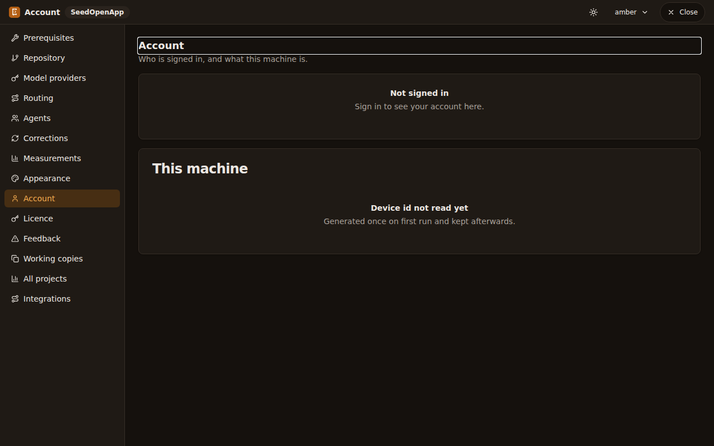

**Call chain:** `SettingsAccount.razor.cs` (an empty class, no method) → no action is called → no table is read

This page is not wired yet. It draws two fixed panels and nothing else. The first always says "Not signed in", and the second always says "Device id not read yet". Both are shown even though the person is signed in: `SecondaryLayout` wraps the page in `AuthGate`, so it cannot be reached without a user.

The data the page should show already exists. The signed-in user is `AppState.CurrentUser` (set by `AccountActions.SignInAsync` and `CurrentUserAsync`), and the device id comes from `IAccountActions.DeviceIdAsync`. The account menu in the main and start windows already shows the name and email from `AppState`. To wire the page, inject `AppState` and `IAccountActions` in the code-behind and replace the two `Empty` blocks.

Sign out is not on this page. It is in the account menu, `Shell/AccountMenu.razor.cs:55`.

| File and line | Function | Watch | Expected value |
|---|---|---|---|
| `src/ChaturUI/Pages/Settings/SettingsAccount.razor:14` | markup, no function | the `Empty` title | always "Not signed in" today |
| `src/ChaturUI/Pages/Settings/SettingsAccount.razor:22` | markup, no function | the `Empty` title | always "Device id not read yet" today |
| `src/ChaturUI/Layouts/AuthGate.razor.cs:36` | `CheckAsync` | `vUser` | the signed-in user; the page is drawn only when this is not `null` |
| `src/Chatur.Core/Accounts/AccountActions.cs:242` | `DeviceIdAsync` | the returned text | the device id; not called by this page today |

**Calculations on this screen:** none

### All projects (`/all-projects`)

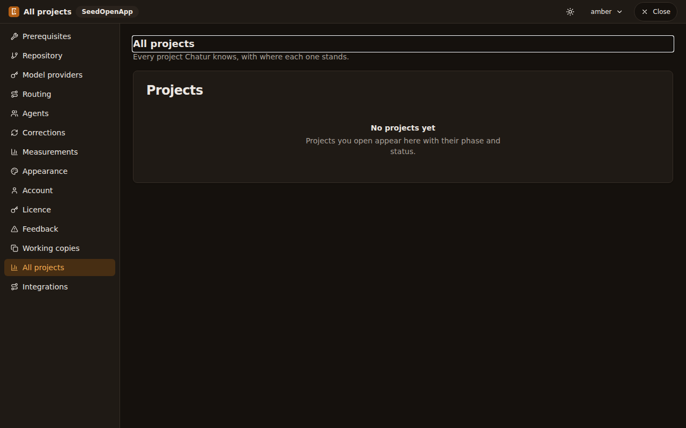

**Call chain:** `AllProjects.razor` (no code-behind file) → no action is called → no table is read

A fixed page for a later phase. It always shows "No projects yet", whatever is in table `Project`. The "All projects" item in the main window's project switcher does not come here; it goes to `/start?all=1`.

| File and line | Function | Watch | Expected value |
|---|---|---|---|
| `src/ChaturUI/Pages/AllProjects.razor:1` | route, no function | the address | `/all-projects` in the secondary window |
| `src/ChaturUI/Pages/AllProjects.razor:18` | markup, no function | the `Empty` title | always "No projects yet" |
| `src/ChaturUI/Layouts/SecondaryNavigation.cs:25` | `Items` | the item's `Route` | `/all-projects` |

**Calculations on this screen:** none

### Working copies (`/worktrees`)

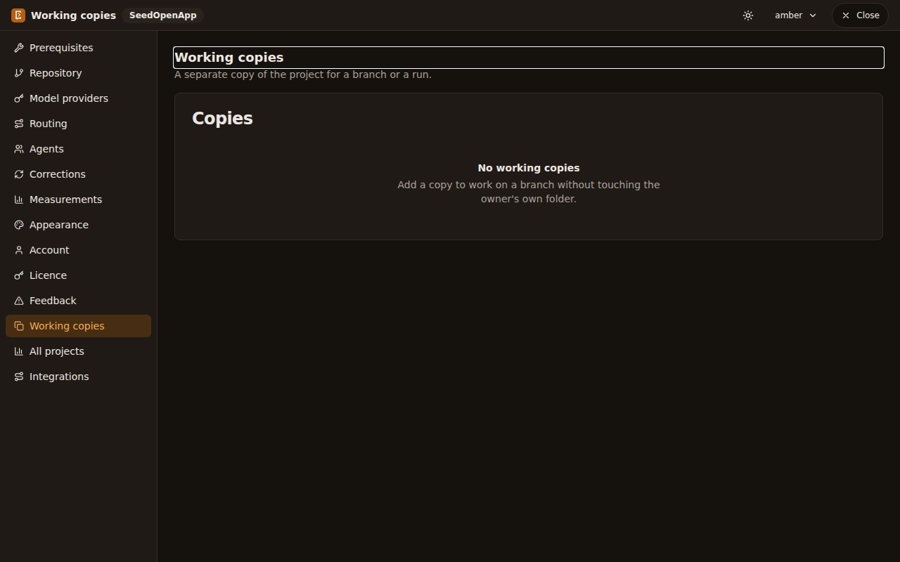

**Call chain:** `Worktrees.razor` (no code-behind file) → no action is called → no table is read

A fixed page for a later phase. It always shows "No working copies" and has no button to add one.

| File and line | Function | Watch | Expected value |
|---|---|---|---|
| `src/ChaturUI/Pages/Worktrees.razor:1` | route, no function | the address | `/worktrees` in the secondary window |
| `src/ChaturUI/Pages/Worktrees.razor:17` | markup, no function | the `Empty` title | always "No working copies" |
| `src/ChaturUI/Layouts/SecondaryNavigation.cs:24` | `Items` | the item's `Route` | `/worktrees` |

**Calculations on this screen:** none

### Licence (`/licence`)

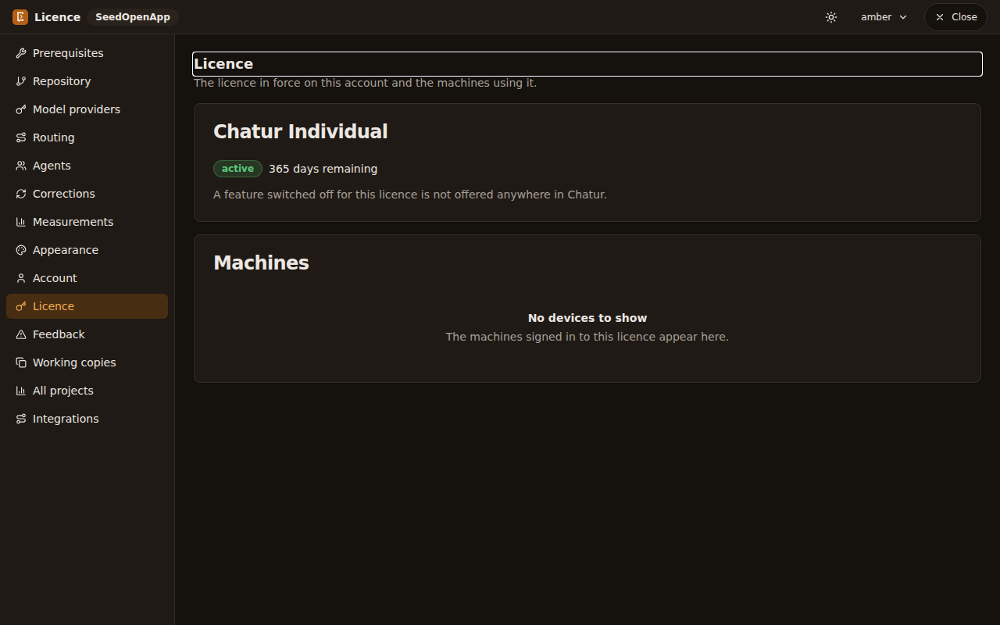

**Call chain:** `Licence.razor` (no code-behind file) → no action is called → no table is read

A fixed page for a later phase. The "active" badge and "365 days remaining" are text typed into the markup, not values read from App Manager. Do not treat them as a real licence state. The machines panel always shows "No devices to show".

| File and line | Function | Watch | Expected value |
|---|---|---|---|
| `src/ChaturUI/Pages/Licence.razor:19` | markup, no function | the badge text | always "active" |
| `src/ChaturUI/Pages/Licence.razor:20` | markup, no function | the days text | always "365 days remaining" |
| `src/ChaturUI/Pages/Licence.razor:31` | markup, no function | the `Empty` title | always "No devices to show" |
| `src/ChaturUI/Shell/AccountMenu.razor:21` | menu item | the route opened | `/licence` |

**Calculations on this screen:** none

### Feedback (`/feedback`)

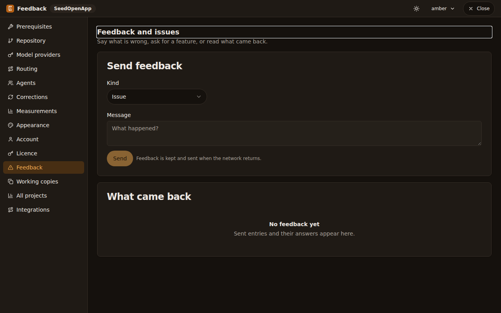

**Call chain:** `Feedback.razor:SendAsync` (in the page's own `@code` block) → `ToastService.Success` → nothing is stored and nothing is sent

The form works on screen only. Send is enabled when the message is not empty. `SendAsync` shows a toast that says the feedback is kept, then clears the box. The text is not written to the database or a file and is not posted to App Manager, so it is lost. The "What came back" panel always shows "No feedback yet". There is no `.razor.cs` file for this page.

| File and line | Function | Watch | Expected value |
|---|---|---|---|
| `src/ChaturUI/Pages/Feedback.razor:60` | `CanSend` | `objMessage` | text that is not empty |
| `src/ChaturUI/Pages/Feedback.razor:62` | `SendAsync` | `objKind`, `objMessage` | `issue` or `idea`; the typed text |
| `src/ChaturUI/Pages/Feedback.razor:70` | `SendAsync` | `objMessage` | empty after this line; the text is gone |

**Calculations on this screen:** none

### Integrations (`/integrations`)

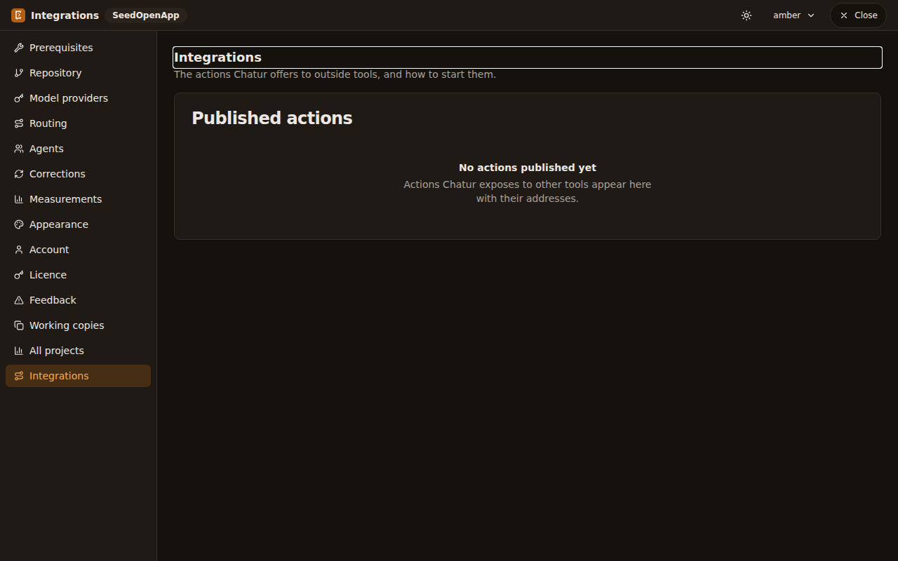

**Call chain:** `Integrations.razor` (no code-behind file) → no action is called → no table is read

A fixed page for a later phase. It always shows "No actions published yet".

| File and line | Function | Watch | Expected value |
|---|---|---|---|
| `src/ChaturUI/Pages/Integrations.razor:1` | route, no function | the address | `/integrations` in the secondary window |
| `src/ChaturUI/Pages/Integrations.razor:18` | markup, no function | the `Empty` title | always "No actions published yet" |
| `src/ChaturUI/Layouts/SecondaryNavigation.cs:26` | `Items` | the item's `Route` | `/integrations` |

**Calculations on this screen:** none

## Cross-cutting flows

### Windows

**Call chain:** `App.xaml.cs:CreateWindow` → `WindowService.CreateStartWindow` → `StartWindowPage` (a `BlazorWebView` whose root is `ChaturUI.ChaturRoutes`)

The design has three windows: start, main and secondary. All three are made in `src/Chatur/Services/WindowService.cs`. Each window is a MAUI `ContentPage` under `src/Chatur/Windows` holding one `BlazorWebView`, and every web view loads the same `ChaturRoutes` router.

- Start window: `CreateStartWindow` (line 18), called once from `App.xaml.cs:26` when the app starts.
- Main window: `ShowMainWindow` (line 22) makes a window from `MainWindowPage`. Nothing in `src` calls it today. When a project is opened, `Start.razor.cs:68` and `:134` navigate the start window's own web view to `/`, so the main window's content appears inside the first window.
- Secondary window: `ShowSecondaryWindow` (line 35). The pages reach it through `ISecondaryWindow.Open`, implemented by `Platform/MauiSecondaryWindow.cs:23`, which moves the call to the main thread. If the window is already open, `SecondaryWindowPage.NavigateTo` (`SecondaryWindowPage.xaml.cs:32`) moves it to the new route and the window is brought forward.

`AppState` is a singleton, so all windows share it. Services registered as scoped, such as `WorkbenchState` and every action class, are separate per web view.

| File and line | Function | Watch | Expected value |
|---|---|---|---|
| `src/Chatur/App.xaml.cs:26` | `CreateWindow` | the returned `Window` | a window whose page is `StartWindowPage` |
| `src/Chatur/Services/WindowService.cs:39` | `ShowSecondaryWindow` | `aRoute`, `objSecondaryWindow` | the route asked for; `null` the first time |
| `src/Chatur/Services/WindowService.cs:50` | `ShowSecondaryWindow` | `aRoute` | the new route when the window is already open |
| `src/Chatur/Windows/SecondaryWindowPage.xaml.cs:35` | `NavigateTo` | the result of `TryDispatchAsync` | `true` while the web view is alive |

### Sign-in

**Call chain:** `AuthGate.razor.cs:CheckAsync` → `AccountActions.CurrentUserAsync` → `ISecretStore.ReadAsync` (and `AppManagerClient.RefreshAsync` when the token has expired)

`StartLayout`, `MainLayout` and `SecondaryLayout` wrap their content in `AuthGate`. `BareLayout` (Sign in, Register) does not. `AuthGate` asks for the current user once when it is first drawn. No user means a move to `/sign-in`. An exception shows an error box with "Try again" and "Sign in again" instead of a blank window.

`CurrentUserAsync` returns `AppState.CurrentUser` when it is set. After a restart it is empty, so the method reads six values from the secret store. Their names are in `Accounts/AccountSecretNames.cs`. If any of the four it needs is missing, there is no user. If the stored expiry time has passed, it calls `AuthSvc/refresh`; a failed refresh clears the stored session and returns no user.

The App Manager client is a typed `HttpClient` set up in `ServiceCollectionExtensions.cs:53`. It takes `AppManager:BaseUrl`, and adds `X-Api-Key` and `X-Api-Secret` headers when those are configured. `AppManagerDeviceIdHandler` adds `X-Device-Id` to every call.

The secret store is `ISecretStore`, implemented by `src/Chatur/Platform/MauiSecretStore.cs`: Windows Credential Manager under the prefix `Chatur:`, and `SecureStorage` on Mac Catalyst. A test run uses its own prefix so it never replaces a real session.

Sign out is `AccountMenu.razor.cs:55`: `AccountActions.SignOutAsync` calls `AuthSvc/logout`, clears the six stored values even when that call fails, clears `AppState.CurrentUser`, and the menu then loads `/sign-in` with a forced reload.

| File and line | Function | Watch | Expected value |
|---|---|---|---|
| `src/ChaturUI/Layouts/AuthGate.razor.cs:36` | `CheckAsync` | `vUser` | the user; `null` sends the window to `/sign-in` |
| `src/Chatur.Core/Accounts/AccountActions.cs:196` | `CurrentUserAsync` | `vAccessToken`, `vRefreshToken`, `vUserId`, `vEmail` | all four not `null` after a remembered sign-in |
| `src/Chatur.Core/Accounts/AccountActions.cs:211` | `CurrentUserAsync` | `vExpiresAt`, `objClock.UtcNow` | expiry later than now; otherwise a refresh is tried |
| `src/Chatur.Core/Accounts/AccountActions.cs:214` | `CurrentUserAsync` | `vRefreshed.Success` | `true`; `false` clears the session |
| `src/Chatur/Platform/MauiSecretStore.cs:41` | `ReadAsync` | `TargetPrefix + aName` | `Chatur:AppManager.AccessToken` and the like |

### The selected project

**Call chain:** `MenuBar.razor.cs:SwitchToAsync` → `ProjectActions.SelectProjectAsync` → tables `Project` and `Setting`, then `AppState.SetSelectedProject`

The selected project lives in two places. In memory it is `AppState.SelectedProject`. On disk it is the `Setting` row with key `SelectedProjectId`. Pages read the first; the second is how the choice survives a restart.

- `SelectProjectAsync` (`ProjectActions.cs:327`) stamps `Project.LastOpenedUtc`, writes the `Setting` row and calls `AppState.SetSelectedProject`.
- `SelectedProjectAsync` (`:300`) reads the `Setting` row joined to `Project` and also sets `AppState`. A new process learns the selection only through this call. Start, Workbench and Repository each make it on load.
- `ProjectOpenActions.CloseProjectAsync` (`ProjectOpenActions.cs:141`) deletes the row and sets `AppState` to nothing.

`AppState.SetSelectedProject` raises `Changed`. Every part of the main window listens. `Workbench.razor.cs:45` compares project ids and calls `WorkbenchTabs.Reset()` to close all tabs. `FilesPanel` reloads the tree, `ConversationPanel.EnsureLoadedAsync` (`:416`) clears and reloads sessions, `OutputStrip` and `AppToolbar` restart their output readers. No navigation happens on a switch.

| File and line | Function | Watch | Expected value |
|---|---|---|---|
| `src/Chatur.Core/Projects/ProjectActions.cs:315` | `SelectedProjectAsync` | `vProject` | the stored project, or `null` when none was ever chosen |
| `src/Chatur.Core/AppState.cs:41` | `SetSelectedProject` | `aProject` | the new project |
| `src/ChaturUI/Pages/Workbench.razor.cs:48` | `OnAppStateChanged` | `vProjectId`, `objProjectId` | different on a real switch; equal means the tabs are kept |
| `src/ChaturUI/Shell/WorkbenchState.cs:396` | `Reset` | `objOpenFiles.Count` | 0 after the call |

### The agent loop and approving a proposed change

**Call chain:** `ConversationPanel.razor.cs:SendMessageAsync` → `AgentActions.SendAsync` → `GuardPipeline.EvaluateAsync` → tables `SessionEvent` and `Change`; then `ConversationPanel.razor.cs:ApproveAsync` → `ChangeActions.ApproveAsync` → `FileActions.SaveAsync` → table `Change`

`SendAsync` (`AgentActions.cs:208`) returns pieces of the reply as they arrive. In order:

1. It loads the session, saves the mode if it changed, and makes a picked agent the session's role (`SetSessionRoleAsync`).
2. It records the message as a `SessionEvent` row of kind `user` and builds the history from the role's wording and past messages.
3. It picks a model: the one chosen in the box, else automatic routing when on, else `ResolveModelAsync` (`:777`), which uses the role's tier. With no connected provider it replies "No model provider is configured yet" and stops.
4. It builds the tier's fallback list. A model that fails before showing any text gives way to the next one.
5. It streams the model's answer through TechieRag. Text goes back to the page at once. Tool calls are collected.
6. Each tool call goes through `GuardPipeline`, which runs `RoleRightsGuard`, `AskMeFirstGuard` and `SourceControlRefusalGuard` in that order (`ServiceCollectionExtensions.cs:149`). An allowed call runs in `ExecuteToolAsync` (`:1061`). A refused call is recorded as kind `refusal`.
7. The loop repeats until an answer has no tool calls, up to `MaxToolIterations` (8, `:28`).
8. The full reply is recorded as kind `assistant` with model name and tokens, and a last chunk with `IsFinal` true is returned.

In "ask me first" mode `AskMeFirstGuard` refuses every file edit. `SendAsync` sees that at `:470` and inserts a `Change` row with status `Proposed`, holding the text before and after. In "go ahead" mode the edit is written at once and recorded as `Approved`.

The page reloads proposed changes after each send (`LoadProposedChangesAsync`, `:507`) and marks those files read-only in the editor. Approve calls `ChangeActions.ApproveAsync` (`ChangeActions.cs:55`): it writes `After` to the file and sets the status to `Approved`; a change that is no longer `Proposed` is left alone. Reject only sets `Rejected`. Stop calls `AgentActions.StopAsync` (`:528`), which cancels through the shared `AgentSessionRegistry`.

| File and line | Function | Watch | Expected value |
|---|---|---|---|
| `src/Chatur.Core/Agent/AgentActions.cs:252` | `SendAsync` | `vModel` | a connected model; `null` gives the "no provider" reply |
| `src/Chatur.Core/Agent/AgentActions.cs:300` | `SendAsync` | `vOpened.Failure`, `vChainIndex` | `null` and 0 when the first model answers |
| `src/Chatur.Core/Agent/AgentActions.cs:464` | `SendAsync` | `vGuardResult.Allowed`, `vGuardResult.RefusalReason` | `false` with a reason that holds "ask me first" for a held edit |
| `src/Chatur.Core/Agent/AgentActions.cs:477` | `SendAsync` | `vToolRequest.FilePath` | the file the agent wants to change |
| `src/Chatur.Core/Changes/ChangeActions.cs:74` | `ApproveAsync` | `vRow.Status` | `Proposed`; anything else returns without writing |
| `src/ChaturUI/Shell/ConversationPanel.razor.cs:862` | `ApproveAsync` | `aChange.FilePath` | the same file; an open tab is reloaded with the new text |

### Build and run output

**Call chain:** `AppToolbar.razor.cs:BuildAsync` → `BuildRunActions.BuildAsync` → `IProcessLauncher.RunAsync` (`dotnet build`); `OutputStrip.razor.cs:ConsumeOutputAsync` → `BuildRunActions.StreamOutputAsync`

Build and Run are in the toolbar and in the Project menu; both call the same action. Run targets come from table `RunTarget`. The first time a project has none, `TargetsAsync` (`BuildRunActions.cs:49`) finds them in the project folder and stores them.

Output is not pushed to the page. `BuildRunActions` keeps one `RunState` per project (`:456`) with a list of lines and a generation number. `BuildAsync` and `RunAsync` call `RunState.Begin` first, which clears the list, raises the generation and cancels the previous run. Each line the process prints is added with `Publish`. `StreamOutputAsync` (`:154`) is a loop that returns new lines every 150 milliseconds and starts again from the top when the generation changes.

Two readers follow that stream. `OutputStrip` draws the lines, sets the status text and collects compiler errors. `AppToolbar.WatchOutputAsync` (`AppToolbar.razor.cs:222`) clears the busy flag when it sees an ending line such as "Build succeeded". The toolbar calls the action before it calls `NotifyBuildOrRunStarted` (`:164`, `:165`), so the list is already cleared when `OutputStrip` restarts its reader. Keep that order.

`RunAsync` returns at once and runs `dotnet run` in the background. Stop cancels the token; the launcher then ends the whole process tree (`MauiProcessLauncher.cs:157`).

| File and line | Function | Watch | Expected value |
|---|---|---|---|
| `src/Chatur.Core/BuildRun/BuildRunActions.cs:83` | `BuildAsync` | `vArguments` | `build`, the project path, `-c` and the configuration |
| `src/Chatur.Core/BuildRun/BuildRunActions.cs:118` | `BuildAsync` | `vExitCode`, `vErrors.Count` | 0 and 0 for a good build |
| `src/Chatur.Core/BuildRun/BuildRunActions.cs:168` | `StreamOutputAsync` | `vState.Generation`, `vGeneration` | equal; a difference resets `vSent` to 0 |
| `src/ChaturUI/Shell/OutputStrip.razor.cs:116` | `ConsumeOutputAsync` | `objStatusText` | "build passed", "build failed", "running" or "stopped" |

### Theme

**Call chain:** `ThemeToggle.razor.cs:ToggleModeAsync` → `ThemeActions.ChooseAsync` → table `Setting`, then `AppState.SetTheme` → `ThemeHost.razor.cs:ApplyAsync` → `ThemeInterop.SetThemeAsync`

`ThemeHost` is drawn once per window by `ChaturRoutes.razor:25`. On start it reads the stored choice with `ThemeActions.CurrentAsync` and sets `AppState`. After the first draw it asks the browser whether the system is dark, then applies the theme. Every later `AppState.Changed` applies it again. A built-in theme is applied by name; the CSS for the four built-in themes is linked in `src/Chatur/wwwroot/index.html:14` to `:17`. A theme added from a file is applied by passing its colour values.

The Sign in and Register pages use `BareLayout`, whose two buttons (`BareLayout.razor.cs:36`) change `AppState` only. That choice is not saved, because nobody is signed in yet.

| File and line | Function | Watch | Expected value |
|---|---|---|---|
| `src/ChaturUI/Shell/ThemeHost.razor.cs:38` | `OnInitializedAsync` | `vCurrent.ThemeName`, `vCurrent.Mode` | the stored choice; amber and dark on a new install |
| `src/ChaturUI/Shell/ThemeToggle.razor.cs:27` | `ToggleModeAsync` | `vMode` | the opposite of what is showing |
| `src/ChaturUI/Services/ThemeInterop.cs:36` | `SetThemeAsync` | `aThemeName`, `aIsDark` | the values now in `AppState` |

### Configuration, logging, errors

- Service registration: `src/Chatur/MauiProgram.cs:77` (`RegisterServices`), which calls `AddChaturCore` (`src/Chatur.Core/ServiceCollectionExtensions.cs:40`) and `AddChaturUI` (`src/ChaturUI/Services/ServiceCollectionExtensions.cs:18`).
- Configuration file: `src/Chatur/appsettings.json`, embedded in the app and loaded at `MauiProgram.cs:142`. It holds `AppManager:BaseUrl` and `AppManager:ApplicationId`.
- User secrets: loaded in Debug builds only, at `MauiProgram.cs:160`. `AppManager:ApiKey` and `AppManager:ApiSecret` are read at `ServiceCollectionExtensions.cs:62` and `:68`. Never put a key in `appsettings.json`.
- Release feed address: key `Chatur:Releases:ApiBaseAddress`, read in `src/Chatur.Core/Prerequisites/ReleaseFeedAddress.cs:21`.
- Data folder and database file: `src/Chatur/Platform/MauiAppPaths.cs:14` and `:21` (`chatur.db`). A test run is sent to its own folder by `src/Chatur.Core/Platform/TestDataGuard.cs:40`.
- Database connection: `src/Chatur.Core/Data/SqliteConnectionFactory.cs:24`; each call opens a new connection and turns foreign keys on.
- Database changes: `ChaturDbMigrator.Migrate` (`src/ChaturDb/ChaturDbMigrator.cs:35`), called at `MauiProgram.cs:56`. A failed migration is logged as fatal and the app still starts.
- Logging: Serilog, set up at `MauiProgram.cs:103`. One file per day, `logs/chatur-.log` under the data folder, 14 files kept. Microsoft sources log from Warning up.
- Unhandled exceptions: `MauiProgram.cs:120`. Unobserved task exceptions: `MauiProgram.cs:129`; they are logged as "Unobserved task exception" and marked observed.
- Errors shown to the person: toasts through `ToastService`, drawn by `ToastProvider` at `src/ChaturUI/ChaturRoutes.razor:20`. Action classes throw `ArgumentException`, `InvalidOperationException` or `KeyNotFoundException`; most pages catch the first two and show the message.
- Sign-in check failure: the error box in `src/ChaturUI/Layouts/AuthGate.razor.cs:48`.

## Known issues

- REQ-FN-024: an earlier reply takes the name of the agent chosen now, because `src/ChaturUI/Shell/ConversationPanel.razor:99` labels every reply with the open session's `RoleName`.
- REQ-FN-022: checked by a hand step; no test drives it.
- REQ-FN-012: can only be checked on the Mac.
- REQ-FN-001, REQ-FN-002, REQ-FN-030, REQ-FN-048, REQ-FN-004: checked by hand steps, not by a test.
- Sign out leaves the window on "Loading Chatur" until the app is reopened; start at the forced reload in `src/ChaturUI/Shell/AccountMenu.razor.cs:58`.
- Closing the secondary window logs an unobserved WebView2 `SendMessage` error; it reaches the log through `src/Chatur/MauiProgram.cs:129`.
