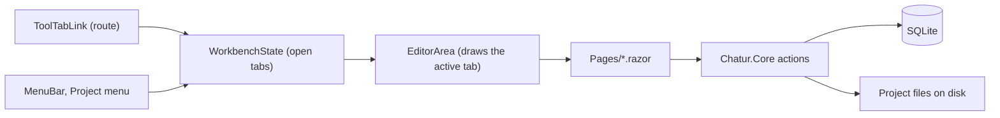
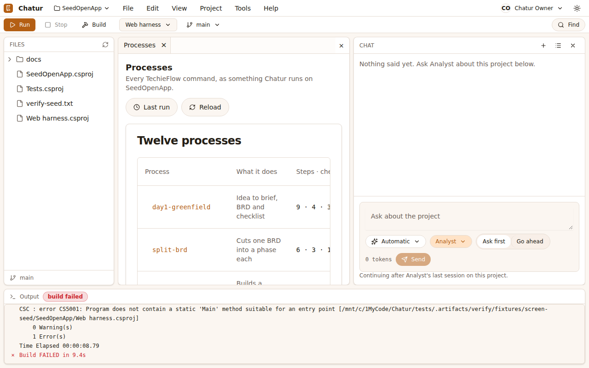
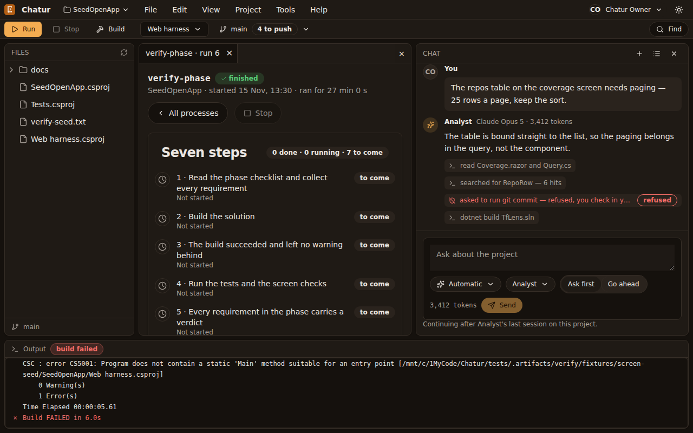
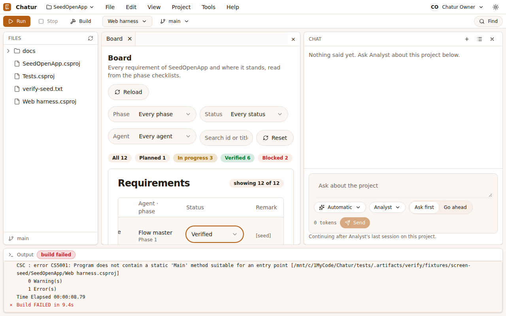
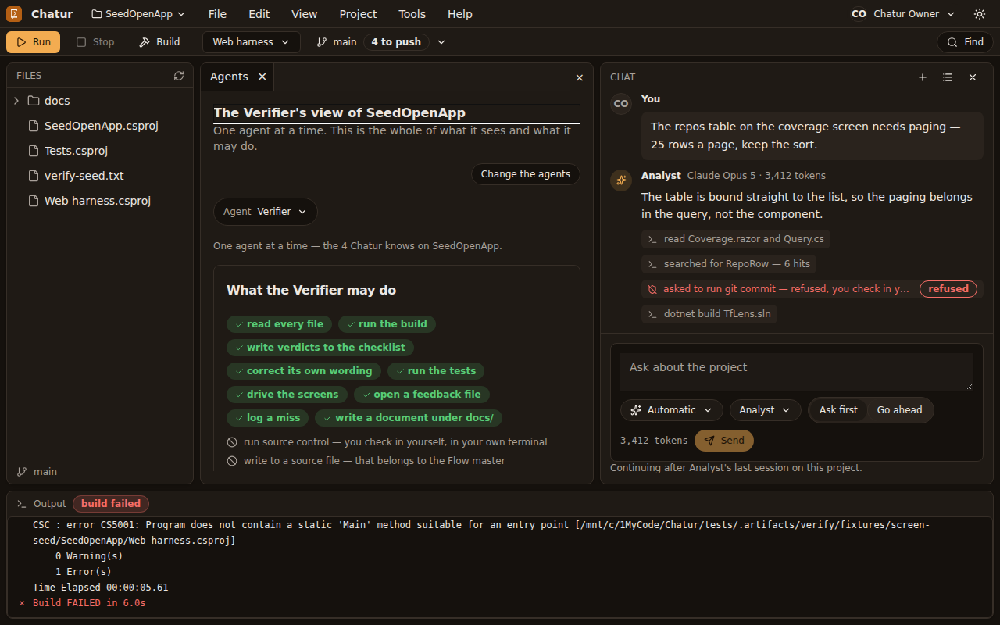

# Chatur — Developer Guide

| | |
|---|---|
| App | Chatur |
| Kind | app |
| Size | Large |
| Phase | 2 of 4 |
| Verified on | 2026-11-15 |
| Date | 2026-11-15 |

## Architecture cheat-sheet

The four phase-2 screens are not pages of their own. Each opens as a tab inside the main window. A route such as `/board` is a deep link handled by `src/ChaturUI/Pages/ToolTabLink.razor.cs` (`OnAfterRenderAsync`, line 44): it opens the tab through `src/ChaturUI/Shell/WorkbenchState.cs` and then goes on to `/`. `src/ChaturUI/Shell/EditorArea.razor` (the `switch` at line 43) draws the active tab's component. The conversation stays on the right of every tab.

| Layer | Project or folder | What lives here |
|---|---|---|
| Tabs | `src/ChaturUI/Shell` | `WorkbenchState.cs` holds the open tabs; `EditorArea.razor` draws the active one; `MenuBar.razor` opens them |
| Screens | `src/ChaturUI/Pages` | `Processes`, `ProcessRun`, `Board`, `AgentWorkspace`, each a `.razor` with a `.razor.cs` |
| Actions | `src/Chatur.Core/Processes`, `ProcessRuns`, `StepAgents`, `Board`, `AgentWorkspace` | One class per interface in `Chatur.Core/Actions`; SQL through Dapper |
| Database | `src/ChaturDb/Scripts` | DbUp scripts `0040` to `0045`: `ProcessStepText`, `ProcessRun`, `ProcessRunStep`, `ProcessRunVerdict`, run evidence, agent rights and commands |
| Project files | the opened project's `docs` folder | `*Checklist*.md` is the only store of the board; `docs/metrics/runs.jsonl` gets one record per run |

## Roles and menu map

| Role | Test user | Menu items and the screen each opens |
|---|---|---|
| User | 1 (chatur-owner@techierathore.com) | Project → Processes (`/processes`); Project → Board (`/board`); Project → Agent workspace (`/workspace/{agent}`). Process run (`/processes/{id}/run`) has no menu item: Start on Processes opens it. |

The items are in `src/ChaturUI/Shell/MenuBar.razor`, lines 152 to 154. Each calls `WorkbenchState.OpenProcesses`, `OpenBoard` or `OpenAgentWorkspace` (through `MenuBar.razor.cs:299`).

## Screen-by-screen code map

### Processes (`/processes`)

**Call chain:** `Processes.razor.cs:StartNowAsync` → `ProcessActions.StartAsync` → `ProcessRun` table (one `INSERT`)

The screen lists the twelve processes from `ProcessCatalogue` and, for the one opened, its steps with the wording held in `ProcessStepText`. `LoadAsync` (line 75) reads the list, the project's documents and the newest run. It opens the process that is running, else the one already open, else the first.

Start works in two ways. For `build-phase`, `verify-phase` and `fix-issues` (`EstimatedProcesses`, line 26) `StartAsync` first asks `EstimateActions.EstimateAsync` and shows the estimate; the run starts only when the owner presses Start on that panel (`ConfirmEstimateAsync`). Every other process starts at once. `StartNowAsync` then writes the run, keeps the confirmed estimate with `EstimateActions.ConfirmAsync`, and opens the Process run tab with `WorkbenchState.OpenProcessRun`.

`ProcessActions.StartAsync` does not start a second run of the same process on the same project. If one is in state `running` it returns that run with `AlreadyRunning` true.

Editing a step's wording (`SaveEditAsync`, line 150) calls `ProcessActions.SaveStepWordingAsync`, which updates `ProcessStepText`, raises its `Version`, and adds a `Correction` row in one transaction.

| File and line | Function | Watch | Expected value |
|---|---|---|---|
| `src/ChaturUI/Pages/Processes.razor.cs:82` | `LoadAsync` | `objProcesses.Count` | 12 |
| `src/ChaturUI/Pages/Processes.razor.cs:193` | `StartAsync` | `aCode` | the code on the row pressed; one of the three estimated codes goes on to line 202 |
| `src/ChaturUI/Pages/Processes.razor.cs:202` | `StartAsync` | `vEstimate` | an estimate, or `null` when the project folder is not known (then the run starts at once) |
| `src/ChaturUI/Pages/Processes.razor.cs:252` | `StartNowAsync` | `vStarted.RunId` | the id of the new run, or of the run already going |
| `src/Chatur.Core/Processes/ProcessActions.cs:194` | `StartAsync` | `vExisting` | `null` unless this process is already running on the project |
| `src/Chatur.Core/Processes/ProcessActions.cs:208` | `StartAsync` | `vRunId` | the new `ProcessRun` row: state `running`, `CurrentStep` 1 |

**Calculations on this screen:** `StepsSummary` (`Processes.razor.cs:45`) counts the opened process's steps, checks and owner stops. `LastRunText` (line 294) turns the last start time into a short date or "never run". `ProcessActions.ListAsync` (`ProcessActions.cs:34`) works out, per process, the last start time and whether a run is going, from the project's `ProcessRun` rows. The estimate shown before Start is computed in `EstimateActions.EstimateAsync` (`src/Chatur.Core/Estimates/EstimateActions.cs:56`), not on this screen.

### Process run (`/processes/{id}/run`)

**Call chain:** `ProcessRun.razor.cs:AdvanceAsync` → `ProcessRunActions.AdvanceAsync` → `ProcessRunActions.AdvanceLockedAsync` → `ProjectStepExecutor.ExecuteAsync` → `ProcessRunStep` and `ProcessRun` tables

The screen shows one run and also carries it on. `OnParametersSetAsync` (line 295) reads the run and, when its state is `Running`, calls `AdvanceAsync`. That call does not return until the run reaches an owner stop, a failed check or its end. While it waits, `ShowingProgressAsync` (line 364) reads the run again every second so each step shows as it lands.

The database holds the run's position (`ProcessRun.CurrentStep`) and one `ProcessRunStep` row per finished step, so a run carries on after a restart. One lock per run (`RunLocks`, `ProcessRunActions.cs:20`) keeps two callers from advancing the same run.

In `AdvanceLockedAsync` an owner stop sets the run to `Waiting` and returns. `AnswerAsync` (page line 394) relays the owner's choice: `Later` leaves the run waiting; any other answer is recorded and the run goes on. A step that does not pass is recorded as `failed` and the run ends as `Stopped`. For `verify-phase`, the verdict step calls `RunVerdictWriter.WriteAsync` (`src/Chatur.Core/ProcessRuns/RunVerdictWriter.cs:64`), which writes each verdict into the checklist file and into `ProcessRunVerdict`.

Stop (`ConfirmStopAsync`, line 480) calls `ProcessRunActions.StopAsync`, which first tells the working agent to stop and then ends the run.

| File and line | Function | Watch | Expected value |
|---|---|---|---|
| `src/ChaturUI/Pages/ProcessRun.razor.cs:307` | `OnParametersSetAsync` | `objRun` | the run with its steps; `null` when the id is not known |
| `src/ChaturUI/Pages/ProcessRun.razor.cs:351` | `AdvanceAsync` | `objRun.State` | `Waiting`, `Stopped` or `Finished` when the call returns |
| `src/Chatur.Core/ProcessRuns/ProcessRunActions.cs:290` | `AdvanceLockedAsync` | `vStep.Kind` | `Step`, `Check` or `OwnerStop` for the step at `vPosition` |
| `src/Chatur.Core/ProcessRuns/ProcessRunActions.cs:333` | `AdvanceLockedAsync` | `vOutcome.Passed` | `true` to go on to the next step; `false` stops the run |
| `src/Chatur.Core/ProcessRuns/ProcessRunActions.cs:408` | `RecordStepAsync` | `aState`, `aResult` | `done` or `failed`, with the sentence the step row shows |
| `src/Chatur.Core/ProcessRuns/ProcessRunActions.cs:434` | `EndRunAsync` | `aState` | `Finished` or `Stopped`; `EndedUtc` is stamped here |

**Calculations on this screen:** `Elapsed` (`ProcessRun.razor.cs:185`) is the end time, or now, minus the start time. `ProgressCount` (line 206) counts steps done, running, waiting, failed and to come. `SoFarLines` (line 89) sets output tokens and seconds so far beside the kept estimate; the two are never combined. `ProcessRunActions.GetAsync` (`ProcessRunActions.cs:112`) sums `Session.TokensOut` and `TokensIn` over the sessions of the run's handed steps. `EndRunAsync` (line 447) computes `duration_s` for the record it appends to `runs.jsonl`.

### Requirements board (`/board`)

**Call chain:** `Board.razor.cs:SetStatusAsync` → `RequirementBoardActions.SetStatusAsync` → `ChecklistDocument.WithStatus` → the project's `docs/*Checklist*.md` file (no database table)

The board has no table of its own. `RequirementBoardActions.LoadAsync` (`src/Chatur.Core/Board/RequirementBoardActions.cs:27`) finds every `docs/*Checklist*.md` file of the selected project, in phase order, reads each from disk and parses it with `ChecklistDocument.Parse`. Nothing is cached: every filter change, every Reload and every status change reads the files again.

The four filters (phase, status, agent, search text) are fields of the page. `BuildFilter` (`Board.razor.cs:48`) turns them into a `RequirementFilter`, and the action applies it after all rows are read, so the counts at the top always cover every requirement.

A checklist uses more status words than the board. `ChecklistDocument.ToBoardStatus` (`ChecklistDocument.cs:42`) folds the file's word into one of four: Planned, In progress, Verified, Blocked. A word that fits none is shown as it is and cannot be chosen (`StatusChoices`, page line 163).

When a project's folder is gone, `LoadAsync` returns an empty board that carries the path it looked in, so the screen can say where.

`OpenScreen` (page line 112) opens the screen a requirement belongs to as a tab, through `WorkbenchState`.

| File and line | Function | Watch | Expected value |
|---|---|---|---|
| `src/ChaturUI/Pages/Board.razor.cs:59` | `LoadAsync` | `objBoard.Items.Count` | the number of requirements left after the filters |
| `src/Chatur.Core/Board/RequirementBoardActions.cs:44` | `LoadAsync` | `vFiles` | `docs/…Checklist….md` names, phase 1 first |
| `src/Chatur.Core/Board/RequirementBoardActions.cs:52` | `LoadAsync` | `vAll.Count` | every requirement of every checklist, before the filters |
| `src/ChaturUI/Pages/Board.razor.cs:138` | `SetStatusAsync` | `aItem.ChecklistFile`, `aStatus` | the file that holds the row, and one of the four board statuses |
| `src/Chatur.Core/Board/RequirementBoardActions.cs:77` | `SetStatusAsync` | `vChanged` | the file's text with one row changed and nothing else |
| `src/Chatur.Core/Board/ChecklistDocument.cs:176` | `RewriteRow` | `vCells[2]`, `vCells[3]` | the file's status word and the percentage that follows from it |

**Calculations on this screen:** `RequirementBoardActions.Count` (`RequirementBoardActions.cs:108`) counts all requirements and those Planned, In progress, Verified and Blocked. `ChecklistDocument.RewriteRow` (`ChecklistDocument.cs:172`) sets the percentage from the new status: Not Started gives 0%, Verified gives 100%, In Progress gives 50% when the old figure was 0 or 100, and any other case keeps the old figure. `ChecklistDocument.PhaseOf` (line 34) reads the phase number from the file name.

### Agent workspace (`/workspace/{agent}`)

**Call chain:** `AgentWorkspace.razor.cs:StartCommandAsync` → `AgentWorkspaceActions.StartCommandAsync` → `Session` table (one `INSERT`), then `WorkbenchState.RequestConversation` → `ConversationPanel.razor.cs:OpenAndSendAsync`

The tab shows one agent's view of the selected project: what it may and may not do, the requirements waiting on it, its commands and the sessions it still has open. `LoadAsync` (line 84) runs whenever the agent code or the project changes; the key `"{Agent}|{ProjectId}"` stops a second read for the same pair.

`AgentWorkspaceActions.WorkspaceAsync` (`src/Chatur.Core/AgentWorkspace/AgentWorkspaceActions.cs:32`) reads `Role`, `RoleRight`, `RoleCommand` and `Session`. An unknown agent code falls back to the first agent. A command that needs a right the agent does not hold is left out of the list, so the screen never offers it (line 50).

The waiting work comes from the board, not the database: `OpenWorkAsync` (page line 118) calls `RequirementBoardActions.LoadAsync` with the agent as the filter and keeps the rows that are Planned, In progress or Blocked.

There are three ways into the conversation, and all go through `WorkbenchState.RequestConversation`:

- A command button: `StartCommandAsync` inserts a `Session` row and sends `*command` as the first message.
- Start on a requirement: `StartRequirementAsync` (line 150) calls `AgentActions.StartSessionAsync` (`src/Chatur.Core/Agent/AgentActions.cs:168`) and sends a first message naming the requirement.
- An open session: `OpenSession` (line 142) opens it with no message.

Picking another agent (`ChooseAgent`, line 128) only changes the tab's agent code. No session is closed.

| File and line | Function | Watch | Expected value |
|---|---|---|---|
| `src/ChaturUI/Pages/AgentWorkspace.razor.cs:105` | `LoadAsync` | `vView.Agent.Code` | the agent in the route, or the first agent when the code is unknown |
| `src/Chatur.Core/AgentWorkspace/AgentWorkspaceActions.cs:44` | `WorkspaceAsync` | `vHeld` | the actions this agent is allowed |
| `src/ChaturUI/Pages/AgentWorkspace.razor.cs:120` | `OpenWorkAsync` | `vBoard.Items` | this agent's requirements, before the three-status filter |
| `src/ChaturUI/Pages/AgentWorkspace.razor.cs:192` | `StartCommandAsync` | `vStart.SessionId`, `vStart.Message` | the new session's id and `*` followed by the command name |
| `src/Chatur.Core/AgentWorkspace/AgentWorkspaceActions.cs:69` | `StartCommandAsync` | `vSessionId` | the new `Session` row: mode `AskFirst`, state `Active` |
| `src/ChaturUI/Shell/ConversationPanel.razor.cs:363` | `OpenAndSendAsync` | `aStart.Message` | the first message, or `null` when a session is only opened |

**Calculations on this screen:** `OpenLine` (`AgentWorkspace.razor.cs:232`) words the count of waiting requirements. `AgentWorkspaceActions.AgentsAsync` (`AgentWorkspaceActions.cs:78`) counts each agent's open sessions on the project. `OpenSessionsAsync` (line 95) counts each session's messages and sums its tokens from `SessionEvent`.

## Cross-cutting flows

For sign-in, configuration and logging: See docs/Chatur-DevGuide.md, Cross-cutting flows.

### A process step handed to an agent

**Call chain:** `ProcessRunActions.AdvanceLockedAsync` → `ProjectStepExecutor.ExecuteHandedAsync` → `StepAgentActions.HandAsync` → `AgentActions.StartSessionAsync` and `AgentActions.SendAsync` → `ProcessRunStepWork`, `Session`, `SessionEvent` tables

In every process except `verify-phase`, a work step goes to the agent that owns the process. `HandAsync` starts a session as that agent, builds the task text from the step's wording, writes a `ProcessRunStepWork` row in state `working`, and sends the task through the same `SendAsync` path the owner's own messages use. When the reply ends, the row is marked `finished` with the agent's last message. A check then judges what the agent left on disk.

The conversation shows that session while the step is worked. `ProcessRunActions.GetAsync` attaches each step's work to the run it returns. On every read, `ProcessRun.razor.cs:AnnounceHanded` looks for a step whose work is `Working` and calls `WorkbenchState.ShowHandedSession`. `ConversationPanel` listens to `HandedSessionChanged`, switches its thread to the agent's session, and reads it again every second. When the step ends, or the Process run tab is closed, `EndHandedSession` sends the conversation back to the owner's own session.

| File and line | Function | Watch | Expected value |
|---|---|---|---|
| `src/Chatur.Core/ProcessRuns/ProjectStepExecutor.cs:100` | `ExecuteHandedAsync` | `vWork.ModelName` | the model that answered; `null` means no model could work the step |
| `src/Chatur.Core/StepAgents/StepAgentActions.cs:75` | `HandAsync` | `vSessionId` | the new agent session; on a resumed step, the earlier one (line 70) |
| `src/Chatur.Core/StepAgents/StepAgentActions.cs:204` | `InsertRowAsync` | `aTask` | the task text sent to the agent |
| `src/ChaturUI/Pages/ProcessRun.razor.cs:153` | `AnnounceHanded` | `vWork.SessionId` | the same session id as the work row |
| `src/ChaturUI/Shell/WorkbenchState.cs:211` | `ShowHandedSession` | `Handed` | the session, agent, model and step label |
| `src/ChaturUI/Shell/ConversationPanel.razor.cs:279` | `ShowHandedAsync` | `vDetail.Summary` | the agent's session, now the one the thread shows |

### The board writes a status change back to the checklist

**Call chain:** `Board.razor.cs:SetStatusAsync` → `RequirementBoardActions.SetStatusAsync` → `ChecklistDocument.WithStatus` → `File.WriteAllTextAsync`

`SetStatusAsync` checks that the file named is one of the selected project's checklists, reads it, and asks `ChecklistDocument.WithStatus` for the changed text. `Rewrite` (`ChecklistDocument.cs:134`) changes the one table row under the status heading, and the matching detail bullet when the file has one. Every other character stays as it was, line endings included. The file is written back with the same byte-order mark it had (`HasBom`, `RequirementBoardActions.cs:115`). A requirement with no row raises `ArgumentException`, which the page shows as a toast. The page then loads the board again from disk.

## Known issues

- None open. 23 of 23 rows of `docs/Chatur-P2-Checklist.md` are Verified on 2026-11-15.
