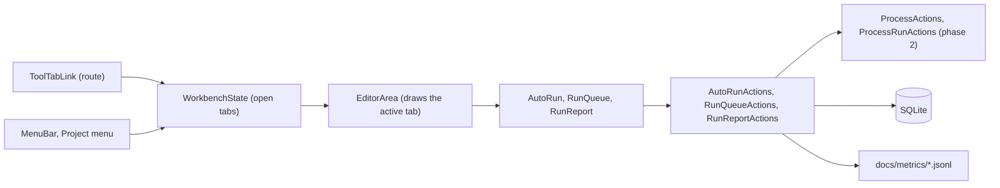
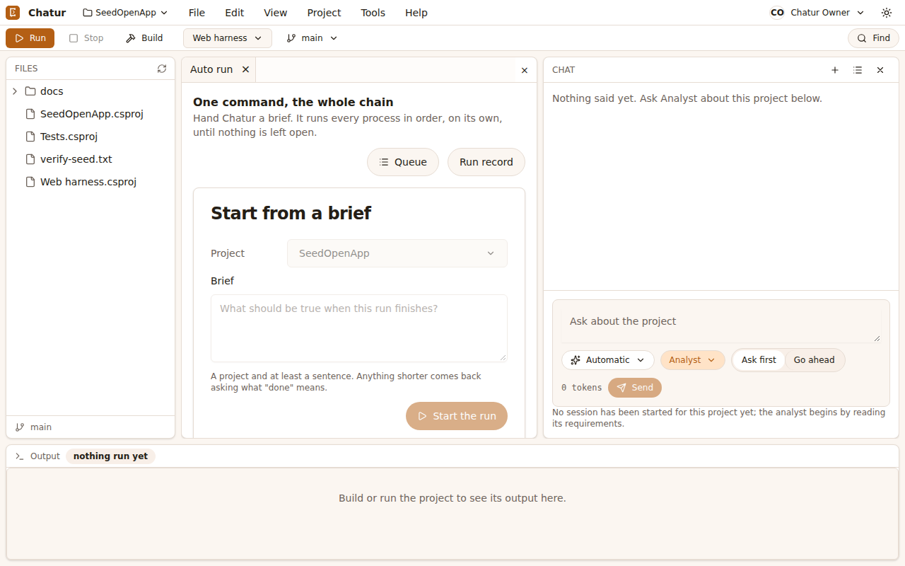
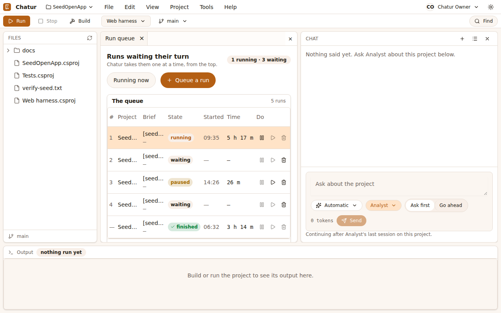
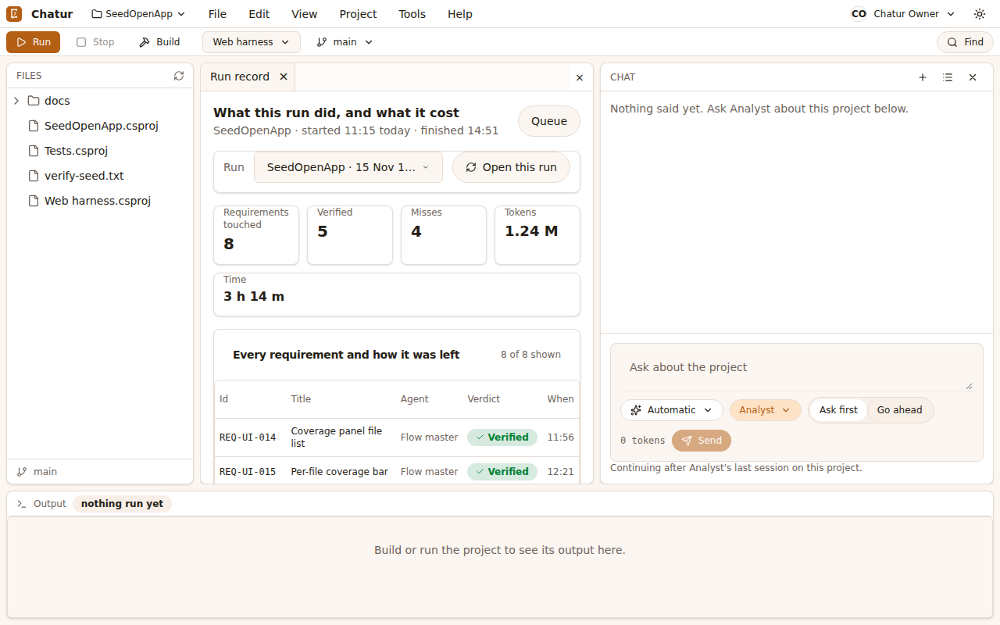

# Chatur — Developer Guide

| | |
|---|---|
| App | Chatur |
| Kind | app |
| Size | Large |
| Phase | 3 of 4 |
| Verified on | 2026-11-15 |
| Date | 2026-11-15 |

## Architecture cheat-sheet

The three phase-3 screens are not pages of their own. Each opens as a tab inside the main window. A route such as `/auto` is a deep link handled by `src/ChaturUI/Pages/ToolTabLink.razor.cs` (`OnAfterRenderAsync`, line 44): it opens the tab through `src/ChaturUI/Shell/WorkbenchState.cs` and then goes on to `/`. `src/ChaturUI/Shell/EditorArea.razor` (the `switch` at line 43) draws the active tab's component.

| Layer | Project or folder | What lives here |
|---|---|---|
| Screens | `src/ChaturUI/Pages` | `AutoRun`, `RunQueue` (with `QueueRunDialog`), `RunReport`, each a `.razor` with a `.razor.cs` |
| Engine | `src/Chatur.Core/AutoRun` | `AutoRunActions` walks the chain; `AutoRunStore` holds the SQL; `AutoRunViewBuilder` builds what the screen shows; `BackgroundAutoRunLauncher` runs it off the screen |
| Queue | `src/Chatur.Core/RunQueue` | `RunQueueActions`; `RequirementOrder` picks the requirement a resumed run works from |
| Report | `src/Chatur.Core/RunReports` | `RunReportActions` and `RunReportReader`; read only |
| Database | `src/ChaturDb/Scripts` | DbUp scripts `0046` to `0057`: `AutoRun`, `AutoRunProcess`, `AutoRunEvent`, `RunQueueItem`, `ProcessRunStepWork`, estimates |

## Roles and menu map

| Role | Test user | Menu items and the screen each opens |
|---|---|---|
| User | 1 (chatur-owner@techierathore.com) | Project → End-to-end run (`/auto`); Project → Run queue (`/auto/queue`); Project → Run record (`/auto/report`), which opens the Run report |

The items are in `src/ChaturUI/Shell/MenuBar.razor`, lines 156 to 158. Each calls `WorkbenchState.OpenAutoRun`, `OpenRunQueue` or `OpenRunReport` directly.

## Screen-by-screen code map

### End-to-end run (`/auto`)

**Call chain:** `AutoRun.razor.cs:StartAsync` → `AutoRunActions.StartAsync` → `AutoRunStore.CreateAsync` → `AutoRun`, `AutoRunProcess` and `AutoRunEvent` tables

The screen starts a run from a brief and then only watches it. The run itself goes on in a background task, so closing the tab does not stop it.

`OnInitializedAsync` (line 116) picks the selected project and calls `LoadRunAsync` (line 147). That takes the project's going run from `AutoRunActions.CurrentAsync`, or, when none is going, its newest run if that one is ready for the owner's acceptance test. `PollAsync` (line 163) then reads the run again every two seconds.

`StartAsync` (line 335) checks that a project is chosen and that the brief has at least 40 characters (`AutoRunBrief.MinLength`). `AutoRunActions.StartAsync` checks the same rule again, refuses a second going run on the same project, writes the run, and hands it to the launcher. The page then keeps the estimate the owner was shown (`KeepStartEstimateAsync`, line 278). A refusal is shown under the brief, and the brief stays filled.

Pause, Resume and Stop all go through `ChangeAsync` (line 374) to the action of the same name. Stop asks first, in a dialog.

Before a run exists, `ChainRows` (line 42) shows the planned chain from `AutoRunActions.PlannedChain`, with every process still to come.

| File and line | Function | Watch | Expected value |
|---|---|---|---|
| `src/ChaturUI/Pages/AutoRun.razor.cs:149` | `LoadRunAsync` | `objRun` | the going run, or `null` when the project has none |
| `src/ChaturUI/Pages/AutoRun.razor.cs:355` | `StartAsync` | `objRun.State` | `Running`, with a new `AutoRunId` |
| `src/Chatur.Core/AutoRun/AutoRunActions.cs:87` | `StartAsync` | result of `GoingAsync` | `null`; a row here means the start is refused |
| `src/Chatur.Core/AutoRun/AutoRunStore.cs:101` | `CreateAsync` | `vId` | the new `AutoRun` row; eight `AutoRunProcess` rows follow, each `ToCome` |
| `src/ChaturUI/Pages/AutoRun.razor.cs:175` | `PollAsync` | `vNow.ProgressPercent`, `vNow.Now` | a rising figure, and the agent, process and step being worked |
| `src/Chatur.Core/AutoRun/AutoRunViewBuilder.cs:46` | `BuildAsync` | `vProcessRun` | the process run the chain is on now |

**Calculations on this screen:** `Elapsed` (`AutoRun.razor.cs:85`) is the end time, or now, minus the start time. `AutoRunViewBuilder.ProgressOf` (`AutoRunViewBuilder.cs:87`) gives the bar's figure: finished processes, plus the share of done steps in the current process run, times 100, divided by the length of the chain; it is 100 once the run is ready for acceptance. `BuildAsync` (lines 51 to 59) adds up `TokensOutSoFar` over the chain's process runs. `OpenRequirementReader.Count` (`OpenRequirementReader.cs:79`) counts the open requirements by status. `EstimateSoFarText` (page line 62) sets the kept build estimate beside the measured figures; the two are never combined.

### Run queue (`/auto/queue`)

**Call chain:** `RunQueue.razor.cs:LoadAsync` → `RunQueueActions.ListAsync` → `RunQueueActions.StartNextAsync` → `AutoRunActions.StartAsync` → `RunQueueItem` and `AutoRun` tables

The queue lets one end-to-end run go at a time. A `RunQueueItem` row holds very little: the project, the brief, a status (`Queued`, `Started` or `Removed`), the id of the run it became, and the requirement a resumed run works from. Where a started run stands is always read from the run itself, in `SnapshotAsync` (`src/Chatur.Core/RunQueue/RunQueueActions.cs:295`), so the queue and the run cannot disagree. A started row whose run cannot be read shows as lost.

Reading the queue is also what moves it on. Every `ListAsync` call first runs `StartNextAsync`. The page calls it on opening and then every four seconds from a timer (`cRefreshEvery`, page line 15), so the next run starts without a click while the tab is open.

Adding a run is done in the dialog: `QueueRunDialog.razor.cs:QueueAsync` (line 127) calls `RunQueueActions.QueueAsync`, which inserts the row and reports whether the project already had an unfinished run in the queue. The brief needs 40 to 4000 characters.

Pause and Resume on a row (`PauseAsync`, `ResumeAsync`, page lines 177 and 182) pass through to the run's own pause and resume. Resuming while another run is going puts the row back to `Queued`, to wait its turn. Remove marks the row `Removed` and stops its run; a running or finished row cannot be removed.

All actions take one shared lock (`Gate`, line 21), so two readers cannot start two runs.

| File and line | Function | Watch | Expected value |
|---|---|---|---|
| `src/ChaturUI/Pages/RunQueue.razor.cs:76` | `LoadAsync` | `objView.Items` | unfinished runs in queue order, then finished runs, newest first |
| `src/Chatur.Core/RunQueue/RunQueueActions.cs:204` | `StartNextAsync` | `vItems` | no item `Running`, or the method returns here |
| `src/Chatur.Core/RunQueue/RunQueueActions.cs:252` | `TryStartAsync` | `vRun.AutoRunId` | the id of the run just started; written to the row on the next line |
| `src/Chatur.Core/RunQueue/RunQueueActions.cs:307` | `SnapshotAsync` | `vState` | `Waiting`, `Running`, `Paused`, `Finished` or `Lost` |
| `src/ChaturUI/Pages/QueueRunDialog.razor.cs:139` | `QueueAsync` | `vAdded.ProjectAlreadyQueued` | `true` when the project already had a run waiting or going |
| `src/Chatur.Core/RunQueue/RunQueueActions.cs:92` | `QueueAsync` | `vId` | the new `RunQueueItem` row, status `Queued` |

**Calculations on this screen:** `CountText` (`RunQueue.razor.cs:33`) counts running rows and waiting rows; a paused row counts as waiting. `RunQueueActions.ToItem` (`RunQueueActions.cs:330`) computes elapsed time as the run's end, or now, minus its start. `SnapshotAsync` (line 308) numbers the unfinished rows. `ElapsedText` (page line 268) words the time as hours and minutes. `EstimateTextOf` (page line 112) shows the middle build figure of the estimate the run was queued with; it reads the kept estimate and never works one out again.

### Run report (`/auto/report`)

**Call chain:** `RunReport.razor.cs:LoadAsync` → `RunReportActions.ReportAsync` → `RunReportActions.AutoReportAsync` → `AutoRunProcess`, `AutoRunEvent` and `ProcessRunVerdict` tables, plus `docs/metrics/runs.jsonl` and `misses.jsonl`

The report is read only, and every call reads again. `OnInitializedAsync` (line 89) asks `RunReportActions.RunsAsync` for the list of runs and loads the newest. The owner can pick an earlier one (`OnPickedAsync`, line 115).

The list has two sources. Runs Chatur carried out come from `AutoRun` rows and have the key `auto-` followed by the row id. End-to-end runs found only in the project's `runs.jsonl` (command `auto`) are listed beside them, keyed by their start time.

`ReportAsync` (`src/Chatur.Core/RunReports/RunReportActions.cs:66`) branches on that key:

- An `auto-` key goes to `AutoReportAsync`. The requirements are the last verdict each one was left at by the run's process runs (`VerdictsAsync`, line 170). Waits and retries come from the run's own record. Misses and tokens come from the measurement files, limited to the time the run was going.
- Any other key goes to `RunReportReader.Report` (`RunReportReader.cs:39`), which builds the whole report from `runs.jsonl`, `gates.jsonl` and `misses.jsonl`.

Titles and owning agents come from the board (`RequirementBoardActions.LoadAsync`). A figure that no record carries is shown as "not recorded", never as zero.

`LoadEstimateAsync` (page line 160) reads the estimate an `auto-` run kept and asks `EstimateActions.AgainstActualAsync` to set it beside what was measured.

| File and line | Function | Watch | Expected value |
|---|---|---|---|
| `src/ChaturUI/Pages/RunReport.razor.cs:93` | `OnInitializedAsync` | `objRuns[0].Key` | `auto-{id}` for a run Chatur carried out |
| `src/ChaturUI/Pages/RunReport.razor.cs:129` | `LoadAsync` | `objReport` | the report; `null` when the run is not the selected project's |
| `src/Chatur.Core/RunReports/RunReportActions.cs:74` | `ReportAsync` | `vRuns.Length` | the number of lines in `runs.jsonl`; 0 when the file is missing |
| `src/Chatur.Core/RunReports/RunReportActions.cs:110` | `AutoReportAsync` | `vVerdicts` | one row per requirement the run graded |
| `src/Chatur.Core/RunReports/RunReportActions.cs:118` | `AutoReportAsync` | `vCost.TokensIn`, `vCost.TokensOut` | totals of the records started inside the run's time; `null` when none carries the figure |
| `src/ChaturUI/Pages/RunReport.razor.cs:185` | `LoadEstimateAsync` | `objAgainst` | the kept estimate against the measured figures |

**Calculations on this screen:** `RunReportActions.WaitsOf` (`RunReportActions.cs:136`) measures each usage-limit wait, from the wait to the entry that ended it. `AutoReportAsync` (line 115) computes the run's duration as end minus start minus the time waited, sums tokens in and out (line 119) and sums the retries of the chain (line 132). `RunReportReader.CostBetween` (`RunReportReader.cs:105`) adds tokens and seconds per model. On the page, `Lay` (`RunReport.razor.cs:197`) builds the Total row with `SumOrNull` (line 231), which gives a sum only when every model's figure was recorded. `VerdictCounts` (line 71) counts requirements per verdict.

## Cross-cutting flows

For sign-in, configuration and logging: See docs/Chatur-DevGuide.md, Cross-cutting flows.

### The end-to-end engine

**Call chain:** `AutoRunActions.StartAsync` → `BackgroundAutoRunLauncher.Launch` → `AutoRunActions.AdvanceAsync` → `CarryOnAsync` → `RunCurrentProcessAsync` → `ProcessActions.StartAsync` and `ProcessRunActions.AdvanceUnattendedAsync`

**Start.** `AutoRunStore.CreateAsync` writes the `AutoRun` row in state `Running` and one `AutoRunProcess` row per process of the chain. The launcher (`src/Chatur.Core/AutoRun/BackgroundAutoRunLauncher.cs:28`) starts one background task per run, in its own service scope. `AdvanceAsync` takes a lock per run, so only one loop carries a run on.

**The chain of eight processes.** `AutoRunChain.Processes` (`AutoRunChain.cs:14`) lists them in order: `day1-greenfield`, `split-brd`, `mockups`, `deploy-checklist`, `build-phase`, `verify-phase`, `fix-issues`, `refresh-status`. For each one, `EnsureProcessRunAsync` starts an ordinary phase-2 process run and `DriveProcessRunAsync` carries it to its end. An owner stop inside a process is answered yes by the run itself and written into the run's record. A check that fails stops the whole run with the reason. After the last process the run goes to `ReadyForAcceptance` and nothing more is run. `MarkCompleteAsync` refuses while any requirement is open.

**Pause and stop.** `PauseAsync` and `StopAsync` only change the run's state in the database. The loop gives way at the next step boundary: before each step, `AdvanceLockedAsync` calls the `ShouldYield` check from `PolicyFor`, which reads that state. A step already being worked is finished first on pause. On stop, `StopProcessRunAsync` ends the current process run. `ResumeAsync` sets `Running` again and launches the loop on the same step.

**Waiting out a usage limit.** `ProcessRunActions.ExecuteUnattendedAsync` marks the step's model calls as made for a run. `AgentActions.SendAsync` then raises a provider's rate limit as `ModelUsageLimitException` instead of showing it as a note. `BeginLimitWaitAsync` sets the run to `WaitingForLimit` with a resume time: the provider's own figure, else 30 minutes, never more than 12 hours (`AutoRunOptions`). `WaitOutAsync` sleeps in 15-second slices and checks each time whether the owner paused or stopped. The run then carries on by itself on the same step. A stalled or crashed step is retried up to three times, with a growing pause, in `RetryAsync`.

| File and line | Function | Watch | Expected value |
|---|---|---|---|
| `src/Chatur.Core/AutoRun/AutoRunActions.cs:278` | `RunCurrentProcessAsync` | `vProcess.ProcessCode` | the chain's code at `aRow.CurrentProcess` |
| `src/Chatur.Core/AutoRun/AutoRunActions.cs:311` | `EnsureProcessRunAsync` | `vStarted.RunId` | the process run for this place in the chain |
| `src/Chatur.Core/AutoRun/AutoRunActions.cs:358` | `DriveProcessRunAsync` | `vView.State` | `Finished` to go on to the next process |
| `src/Chatur.Core/ProcessRuns/ProcessRunActions.cs:285` | `AdvanceLockedAsync` | result of `vShouldYield()` | `false` while the run is `Running`; `true` after Pause or Stop |
| `src/Chatur.Core/Agent/AgentActions.cs:392` | `SendAsync` | `vUsageLimit` | set when the provider reported a rate limit during a run |
| `src/Chatur.Core/AutoRun/AutoRunActions.cs:476` | `BeginLimitWaitAsync` | `vUntil` | the time the run carries on, saved as `AutoRun.ResumeAtUtc` |

### The queue starts the next run

`RunQueueActions.StartNextAsync` (`RunQueueActions.cs:201`) runs at the start of every `ListAsync`. If any row is running it does nothing. Otherwise it tries each waiting row in order (`TryStartAsync`, line 242). A row that already has a run is resumed; a new row calls `AutoRunActions.StartAsync`, stores the new run's id on the row, and carries the queued estimate over to the run. A project that already has a run going is skipped and stays waiting.

Nothing in the background calls `ListAsync`. The next run starts when a Run queue tab is open and its four-second timer fires.

### Where the run report reads its measurements

`RunReportActions.ReadAsync` (`RunReportActions.cs:188`) reads `runs.jsonl`, `misses.jsonl` and `gates.jsonl` from the selected project's `docs/metrics` folder; a missing file reads as empty. The records are written elsewhere: `ProcessRunActions.EndRunAsync` appends one `runs.jsonl` record per process run through `MeasurementActions.AppendAsync` (`src/Chatur.Core/Measurements/MeasurementActions.cs:196`). For a run Chatur carried out, verdicts come from the `ProcessRunVerdict` table, and waits and retries from `AutoRunEvent` and `AutoRunProcess`.

## Known issues

- A run cut off by closing Chatur resumes when End-to-end run opens. `AutoRunActions.CurrentAsync` (`src/Chatur.Core/AutoRun/AutoRunActions.cs:139`) launches the run again and adds a Retry entry to its record; until that screen is opened the run stands still.
- Fixed on 2026-11-15, REQ-UI-055: the web test copy now releases a closed page at once (`src/Chatur.WebHarness/Program.cs:50`, `DisconnectedCircuitMaxRetained = 0`; test `tests/verify/deep-link-after-closed-pages.spec.ts`). Before that, End-to-end run could stand blank for seconds after a test run.
